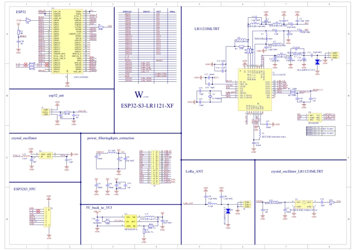
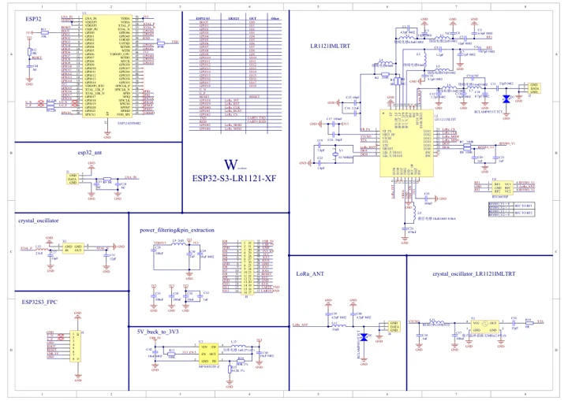

# ESP32-S3-LR1121-XF

**Waveshare** · ESP32-S3

Revision: Not identified

Coverage: Manufacturer references available; physical pinout and complete connector review are tracked separately

[Browse all manufacturers](../../../../BROWSE.md) · [Devices & IoT](../../../../DEVICES.md) · [Open in the browser guide](https://valleytech-black-wire-guide.pages.dev/?board=waveshare-esp32-esp32-s3-lr1121-xf)

## Datasheets and original documentation

Board datasheet: **not yet recorded**. Visual reference: **available**.

[Manufacturer model documentation](https://docs.waveshare.com/ESP32-S3-LR1121-XF/Resources-And-Documents)

- **schematic / board**: [ESP32-S3-LR1121-HF Schematic Diagram — schematic](https://github.com/waveshareteam/ESP32-S3-LR1121-XF/raw/main/hardware/schematics/ESP32-S3-LR1121-HF.pdf) · [saved document](../../../../library/media/a405de6ab30e5d48ac586250a487eee6e9f68e143661895ccef55d3bb05f264c.pdf)
- **schematic / board**: [ESP32-S3-LR1121-LF Schematic Diagram — schematic](https://github.com/waveshareteam/ESP32-S3-LR1121-XF/raw/main/hardware/schematics/ESP32-S3-LR1121-LF.pdf) · [saved document](../../../../library/media/f311b44f5cc04521c1c3fa2f0bd9bb6c1997044fc4ab9f086c856bc9dec241f8.pdf)

A chip datasheet, schematic and board datasheet have different scopes. Match the exact hardware revision.

[Documentation coverage and remaining gaps](../../../../DOCUMENTATION.md)

## Pinout

**pinout image** · Reviewed source · JPG

[Open original reference](../../../../library/media/95ae821190236f783680935e8332d13e756d3357b164355ea6fb8b5e97f4b7f2.jpg)

**Credit and rights:** Not recorded; retain original attribution. Source/manufacturer: Waveshare.

[Source 1](https://www.waveshare.com/img/devkit/ESP32-S3-LR1121-HF/ESP32-S3-LR1121-HF-details-inter.jpg) · [Source 2](https://www.waveshare.com/esp32-s3-lr1121.htm)

Image revision: Not identified

SHA-256: `95ae821190236f783680935e8332d13e756d3357b164355ea6fb8b5e97f4b7f2`

## ESP32-S3-LR1121-HF Schematic Diagram — schematic

**reference PDF** · Source model/link and PDF signature/title checked; individual pin assignments and electrical validation pending · PDF

[Open original reference](../../../../library/media/a405de6ab30e5d48ac586250a487eee6e9f68e143661895ccef55d3bb05f264c.pdf)

**Credit and rights:** Original publisher/manufacturer artwork; redistribution and print rights not established. Attribution is not a license grant.. Source/manufacturer: Waveshare.

[Source 1](https://github.com/waveshareteam/ESP32-S3-LR1121-XF/raw/main/hardware/schematics/ESP32-S3-LR1121-HF.pdf) · [Source 2](https://docs.waveshare.com/ESP32-S3-LR1121-XF/Resources-And-Documents)

Original document linked from this model’s manufacturer page. Preserve the document’s exact revision and named subassembly scope; a linked accessory schematic is not a whole-device pinout. This is a circuit schematic, not a physical board pinout.

Image revision: Use the revision printed in the original document; do not assume all hardware revisions are interchangeable

SHA-256: `a405de6ab30e5d48ac586250a487eee6e9f68e143661895ccef55d3bb05f264c`

## ESP32-S3-LR1121-LF Schematic Diagram — schematic

**reference PDF** · Source model/link and PDF signature/title checked; individual pin assignments and electrical validation pending · PDF

[Open original reference](../../../../library/media/f311b44f5cc04521c1c3fa2f0bd9bb6c1997044fc4ab9f086c856bc9dec241f8.pdf)

**Credit and rights:** Original publisher/manufacturer artwork; redistribution and print rights not established. Attribution is not a license grant.. Source/manufacturer: Waveshare.

[Source 1](https://github.com/waveshareteam/ESP32-S3-LR1121-XF/raw/main/hardware/schematics/ESP32-S3-LR1121-LF.pdf) · [Source 2](https://docs.waveshare.com/ESP32-S3-LR1121-XF/Resources-And-Documents)

Original document linked from this model’s manufacturer page. Preserve the document’s exact revision and named subassembly scope; a linked accessory schematic is not a whole-device pinout. This is a circuit schematic, not a physical board pinout.

Image revision: Use the revision printed in the original document; do not assume all hardware revisions are interchangeable

SHA-256: `f311b44f5cc04521c1c3fa2f0bd9bb6c1997044fc4ab9f086c856bc9dec241f8`

Pin assignments have not been independently electrically verified. Check board revision before wiring.
