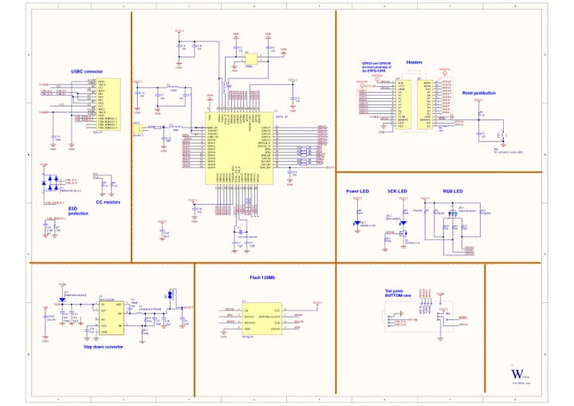

# ESP32-S3-Nano

**Waveshare** · ESP32-S3

Revision: Not identified

Coverage: Manufacturer references available; physical pinout and complete connector review are tracked separately

[Browse all manufacturers](../../../../BROWSE.md) · [Devices & IoT](../../../../DEVICES.md) · [Open in the browser guide](https://valleytech-black-wire-guide.pages.dev/?board=waveshare-esp32-esp32-s3-nano)

## Datasheets and original documentation

Board datasheet: **not yet recorded**. Visual reference: **available**.

[Manufacturer model documentation](https://docs.waveshare.com/ESP32-S3-Nano/Resources-And-Documents)

- **schematic / board**: [ESP32-S3-Nano Schematic — schematic](https://files.waveshare.com/wiki/ESP32-S3-Nano/ESP32-S3-Nano-Schematic.pdf) · [saved document](../../../../library/media/2da93c3246913781aa454845dc89b8a134e66a4f23e8addaa5b89d5e5b6e7a1c.pdf)

A chip datasheet, schematic and board datasheet have different scopes. Match the exact hardware revision.

[Documentation coverage and remaining gaps](../../../../DOCUMENTATION.md)

## Pinout

**pinout image** · Reviewed source · WEBP

[Open original reference](../../../../library/media/c33bb3f3f5ccb9c26f3979d3d9e80e1a0e6e840ed0f509233b46c20d48a005db.webp)

**Credit and rights:** Not recorded; retain original attribution. Source/manufacturer: Waveshare.

[Source 1](https://docs.waveshare.com/assets/images/ESP32-S3-Nano-details-inter-1-c806cf5e83bb5f6f6f71fc5bad2239c7.webp) · [Source 2](https://docs.waveshare.com/ESP32-S3-Nano)

Image revision: Not identified

SHA-256: `c33bb3f3f5ccb9c26f3979d3d9e80e1a0e6e840ed0f509233b46c20d48a005db`

## Pinout

**pinout image** · Reviewed source · JPG

[Open original reference](../../../../library/media/6b2b8fa57ecd4e8774f13e995d98c247f5442ba77059c5569dc6a512d9809df5.jpg)

**Credit and rights:** Not recorded; retain original attribution. Source/manufacturer: Waveshare.

[Source 1](https://www.waveshare.com/w/upload/2/2d/ESP32-S3-Nano_Version3.jpg) · [Source 2](https://www.waveshare.com/wiki/ESP32-S3-Nano) · [Source 3](https://www.waveshare.com/esp32-s3-nano.htm)

Image revision: Not identified

SHA-256: `6b2b8fa57ecd4e8774f13e995d98c247f5442ba77059c5569dc6a512d9809df5`

## ESP32-S3-Nano Schematic — schematic

**reference PDF** · Source model/link and PDF signature/title checked; individual pin assignments and electrical validation pending · PDF

[Open original reference](../../../../library/media/2da93c3246913781aa454845dc89b8a134e66a4f23e8addaa5b89d5e5b6e7a1c.pdf)

**Credit and rights:** Original publisher/manufacturer artwork; redistribution and print rights not established. Attribution is not a license grant.. Source/manufacturer: Waveshare.

[Source 1](https://files.waveshare.com/wiki/ESP32-S3-Nano/ESP32-S3-Nano-Schematic.pdf) · [Source 2](https://docs.waveshare.com/ESP32-S3-Nano/Resources-And-Documents)

Original document linked from this model’s manufacturer page. Preserve the document’s exact revision and named subassembly scope; a linked accessory schematic is not a whole-device pinout. This is a circuit schematic, not a physical board pinout.

Image revision: Use the revision printed in the original document; do not assume all hardware revisions are interchangeable

SHA-256: `2da93c3246913781aa454845dc89b8a134e66a4f23e8addaa5b89d5e5b6e7a1c`

Pin assignments have not been independently electrically verified. Check board revision before wiring.
