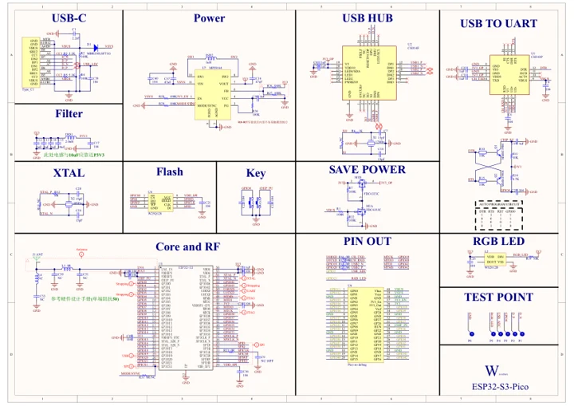

# ESP32-S3-Pico

**Waveshare** · ESP32-S3

Revision: Not identified

Coverage: Manufacturer references available; physical pinout and complete connector review are tracked separately

[Browse all manufacturers](../../../../BROWSE.md) · [Devices & IoT](../../../../DEVICES.md) · [Open in the browser guide](https://valleytech-black-wire-guide.pages.dev/?board=waveshare-esp32-esp32-s3-pico)

## Datasheets and original documentation

Board datasheet: **not yet recorded**. Visual reference: **available**.

[Manufacturer model documentation](https://docs.waveshare.com/ESP32-S3-Pico/Resources-And-Documents)

- **schematic / board**: [ESP32-S3-Pico Schematic — schematic](https://files.waveshare.com/wiki/ESP32-S3-Pico/ESP32-S3-Pico-Schematics.pdf) · [saved document](../../../../library/media/cb89563a2cbb8faf67d3487cd250c1b41c666986a7e52e824173e79e89725472.pdf)

A chip datasheet, schematic and board datasheet have different scopes. Match the exact hardware revision.

[Documentation coverage and remaining gaps](../../../../DOCUMENTATION.md)

## Pinout

**pinout image** · Reviewed source · WEBP

[Open original reference](../../../../library/media/fc8a1e69c46cded150da4bc8e65ba68180529324e81f72c8b270485e57ac7b82.webp)

**Credit and rights:** Not recorded; retain original attribution. Source/manufacturer: Waveshare.

[Source 1](https://docs.waveshare.com/assets/images/ESP32-S3-Pico-details-inter-ccf703ca905565eb0ef0c703a983187d.webp) · [Source 2](https://docs.waveshare.com/ESP32-S3-Pico)

Image revision: Not identified

SHA-256: `fc8a1e69c46cded150da4bc8e65ba68180529324e81f72c8b270485e57ac7b82`

## Pinout

**pinout image** · Reviewed source · JPG

[Open original reference](../../../../library/media/dbe380d2eb31978d22697ccd6437dfd9de015424c994de97c4460b6217892270.jpg)

**Credit and rights:** Not recorded; retain original attribution. Source/manufacturer: Waveshare.

[Source 1](https://www.waveshare.com/w/upload/9/90/ESP32-S3-Pico-details-inter-1.jpg) · [Source 2](https://www.waveshare.com/wiki/ESP32-S3-Pico) · [Source 3](https://www.waveshare.com/esp32-s3-pico.htm)

Image revision: Not identified

SHA-256: `dbe380d2eb31978d22697ccd6437dfd9de015424c994de97c4460b6217892270`

## ESP32-S3-Pico Schematic — schematic

**reference PDF** · Source model/link and PDF signature/title checked; individual pin assignments and electrical validation pending · PDF

[Open original reference](../../../../library/media/cb89563a2cbb8faf67d3487cd250c1b41c666986a7e52e824173e79e89725472.pdf)

**Credit and rights:** Original publisher/manufacturer artwork; redistribution and print rights not established. Attribution is not a license grant.. Source/manufacturer: Waveshare.

[Source 1](https://files.waveshare.com/wiki/ESP32-S3-Pico/ESP32-S3-Pico-Schematics.pdf) · [Source 2](https://docs.waveshare.com/ESP32-S3-Pico/Resources-And-Documents)

Original document linked from this model’s manufacturer page. Preserve the document’s exact revision and named subassembly scope; a linked accessory schematic is not a whole-device pinout. This is a circuit schematic, not a physical board pinout.

Image revision: Use the revision printed in the original document; do not assume all hardware revisions are interchangeable

SHA-256: `cb89563a2cbb8faf67d3487cd250c1b41c666986a7e52e824173e79e89725472`

Pin assignments have not been independently electrically verified. Check board revision before wiring.
