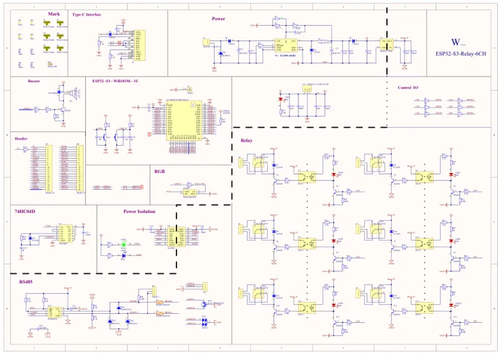

# ESP32-S3-Relay-6CH

**Waveshare** · ESP32-S3

Revision: Not identified

Coverage: Manufacturer references available; physical pinout and complete connector review are tracked separately

[Browse all manufacturers](../../../../BROWSE.md) · [Devices & IoT](../../../../DEVICES.md) · [Open in the browser guide](https://valleytech-black-wire-guide.pages.dev/?board=waveshare-esp32-esp32-s3-relay-6ch)

## Datasheets and original documentation

Board datasheet: **not yet recorded**. Visual reference: **available**.

[Manufacturer model documentation](https://www.waveshare.com/wiki/ESP32-S3-Relay-6CH)

- **schematic / board**: [ESP32-S3-Relay-6CH Schematic diagram — schematic](https://files.waveshare.com/wiki/ESP32-S3-Relay-6CH/ESP32-S3-Relay-6CH.pdf) · [saved document](../../../../library/media/cdea94003baa8d2bffeaf7149a35097cbf888048f21ea8d4d79d121c9adaa8b1.pdf)

A chip datasheet, schematic and board datasheet have different scopes. Match the exact hardware revision.

[Documentation coverage and remaining gaps](../../../../DOCUMENTATION.md)

## Pinout

**pinout image** · Reviewed source · WEBP

[Open original reference](../../../../library/media/f5aea5c7a2159c8e07d07652f770da1a463ae02da85c2c3ba2e0c1f1c7c200df.webp)

**Credit and rights:** Not recorded; retain original attribution. Source/manufacturer: Waveshare.

[Source 1](https://docs.waveshare.com/assets/images/ESP32-S3-Relay-6CH-introduction-02-ffdf4390ad72784e806082cd72336f41.webp) · [Source 2](https://docs.waveshare.com/ESP32-S3-Relay-6CH)

Image revision: Not identified

SHA-256: `f5aea5c7a2159c8e07d07652f770da1a463ae02da85c2c3ba2e0c1f1c7c200df`

## Pinout

**pinout image** · Reviewed source · JPG

[Open original reference](../../../../library/media/38fdb2f6b11cbd10a5cd18e62117f3be4c2c3b26504db35a5a604bc6dd6a443a.jpg)

**Credit and rights:** Not recorded; retain original attribution. Source/manufacturer: Waveshare.

[Source 1](https://www.waveshare.com/w/upload/0/0a/ESP32-S3-Relay-6CH-introduction-02.jpg) · [Source 2](https://www.waveshare.com/wiki/ESP32-S3-Relay-6CH)

Image revision: Not identified

SHA-256: `38fdb2f6b11cbd10a5cd18e62117f3be4c2c3b26504db35a5a604bc6dd6a443a`

## ESP32-S3-Relay-6CH Schematic diagram — schematic

**reference PDF** · Source model/link and PDF signature/title checked; individual pin assignments and electrical validation pending · PDF

[Open original reference](../../../../library/media/cdea94003baa8d2bffeaf7149a35097cbf888048f21ea8d4d79d121c9adaa8b1.pdf)

**Credit and rights:** Original publisher/manufacturer artwork; redistribution and print rights not established. Attribution is not a license grant.. Source/manufacturer: Waveshare.

[Source 1](https://files.waveshare.com/wiki/ESP32-S3-Relay-6CH/ESP32-S3-Relay-6CH.pdf) · [Source 2](https://www.waveshare.com/wiki/ESP32-S3-Relay-6CH)

Original document linked from this model’s manufacturer page. Preserve the document’s exact revision and named subassembly scope; a linked accessory schematic is not a whole-device pinout. This is a circuit schematic, not a physical board pinout.

Image revision: Use the revision printed in the original document; do not assume all hardware revisions are interchangeable

SHA-256: `cdea94003baa8d2bffeaf7149a35097cbf888048f21ea8d4d79d121c9adaa8b1`

Pin assignments have not been independently electrically verified. Check board revision before wiring.
