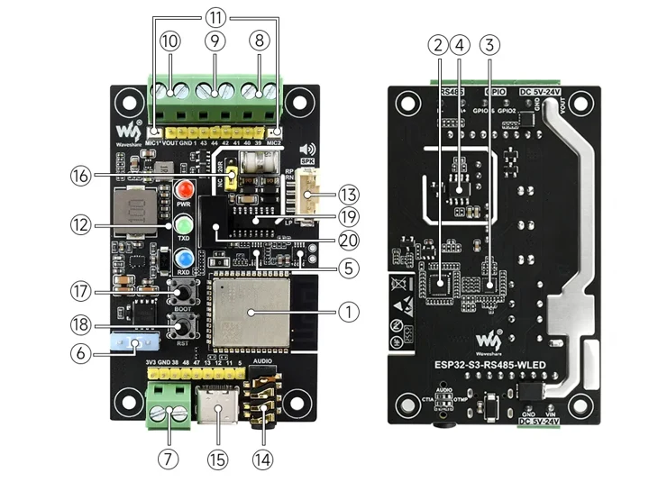

# ESP32-S3-RS485-WLED

**Waveshare** · ESP32-S3

Revision: Match the original board revision

Coverage: Partial manufacturer references; all-connector review pending

[Browse all manufacturers](../../../../BROWSE.md) · [Devices & IoT](../../../../DEVICES.md) · [Open in the browser guide](https://valleytech-black-wire-guide.pages.dev/?board=waveshare-esp32-s3-rs485-wled)

## Datasheets and original documentation

Board datasheet: **not yet recorded**. Visual reference: **available**.

[Manufacturer hardware documentation](https://docs.waveshare.com/ESP32-S3-RS485-WLED)

- **hardware-guide / board**: [Manufacturer specifications and hardware documentation](https://docs.waveshare.com/ESP32-S3-RS485-WLED) · online

A chip datasheet, schematic and board datasheet have different scopes. Match the exact hardware revision.

[Documentation coverage and remaining gaps](../../../../DOCUMENTATION.md)

## Hardware and terminal locations

**board labeling image** · Visually reviewed for identity and reference scope; independent electrical and all-connector review pending · WEBP

[Open original reference](../../../../library/media/0ce75fa2bf525e202152241dfab213e579226b9ba1e5c98db2b86a009c560b0a.webp)

**Credit and rights:** Manufacturer artwork; reuse and print rights not established. Inclusion does not relicense the original.. Source/manufacturer: Waveshare.

[Source 1](https://docs.waveshare.com/assets/images/ESP32-S3-RS485-WLED-details-intro-dde34fb81e801d1913533588e6b695f5.webp) · [Source 2](https://docs.waveshare.com/ESP32-S3-RS485-WLED)

Numbered hardware overview; use the manufacturer legend and terminal silkscreen. Not a complete pinout.

Image revision: Match the original board revision

SHA-256: `0ce75fa2bf525e202152241dfab213e579226b9ba1e5c98db2b86a009c560b0a`

Pin assignments have not been independently electrically verified. Check board revision before wiring.
