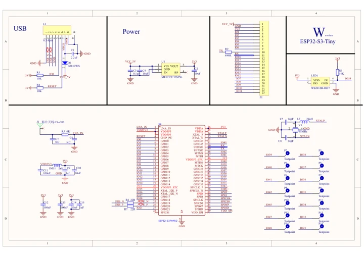
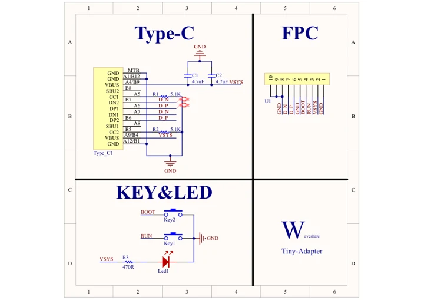

# ESP32-S3-Tiny

**Waveshare** · ESP32-S3

Revision: Not identified

Coverage: Manufacturer references available; physical pinout and complete connector review are tracked separately

[Browse all manufacturers](../../../../BROWSE.md) · [Devices & IoT](../../../../DEVICES.md) · [Open in the browser guide](https://valleytech-black-wire-guide.pages.dev/?board=waveshare-esp32-esp32-s3-tiny)

## Datasheets and original documentation

Board datasheet: **not yet recorded**. Visual reference: **available**.

[Manufacturer model documentation](https://docs.waveshare.com/ESP32-S3-Tiny/Resources-And-Documents)

- **schematic / board**: [ESP32-S3-Tiny Schematic — schematic](https://files.waveshare.com/wiki/ESP32-S3-Tiny/ESP32-S3-Tiny-Sch.pdf) · [saved document](../../../../library/media/7a1069dc3c1f966f6bcea56c25272cb8ad3a7f992c46a194e6a1fdfe5b503b14.pdf)
- **schematic / board**: [ESP32-S3-Tiny Adapter Schematic — schematic](https://files.waveshare.com/wiki/ESP32-S3-Tiny/Tiny-Adapter.pdf) · [saved document](../../../../library/media/05bab7dddf85759c838841c4a9cee4942cbe7509d431ba85e4119d06a05aa96c.pdf)

A chip datasheet, schematic and board datasheet have different scopes. Match the exact hardware revision.

[Documentation coverage and remaining gaps](../../../../DOCUMENTATION.md)

## Pinout

**pinout image** · Reviewed source · JPG

[Open original reference](../../../../library/media/ca73c19d54de06bcbcf9a03c65a182e99ea4db90e6e13f8a5967614b0f31dd81.jpg)

**Credit and rights:** Not recorded; retain original attribution. Source/manufacturer: Waveshare.

[Source 1](https://www.waveshare.com/img/devkit/ESP32-S3-Tiny/ESP32-S3-Tiny-details-inter.jpg) · [Source 2](https://www.waveshare.com/esp32-s3-tiny.htm)

Image revision: Not identified

SHA-256: `ca73c19d54de06bcbcf9a03c65a182e99ea4db90e6e13f8a5967614b0f31dd81`

## Pinout

**pinout image** · Reviewed source · JPG

[Open original reference](../../../../library/media/d6ba0edc0f5a3215e9526effc8765ba45bc7bb7f5127aec86521ff5ea1893834.jpg)

**Credit and rights:** Not recorded; retain original attribution. Source/manufacturer: Waveshare.

[Source 1](https://www.waveshare.com/w/upload/9/93/ESP32-S3-Tiny-pinout.jpg) · [Source 2](https://www.waveshare.com/wiki/ESP32-S3-Tiny)

Image revision: Not identified

SHA-256: `d6ba0edc0f5a3215e9526effc8765ba45bc7bb7f5127aec86521ff5ea1893834`

## Pinout

**pinout image** · Reviewed source · WEBP

[Open original reference](../../../../library/media/23a8bd9f469d612283eee8a5b0fc759965da5751f41a7830b0741988389eb675.webp)

**Credit and rights:** Not recorded; retain original attribution. Source/manufacturer: Waveshare.

[Source 1](https://docs.waveshare.com/assets/images/ESP32-S3-Tiny-details-inter-fc4d043c04724600472e4ce8f10429a7.webp) · [Source 2](https://docs.waveshare.com/ESP32-S3-Tiny)

Image revision: Not identified

SHA-256: `23a8bd9f469d612283eee8a5b0fc759965da5751f41a7830b0741988389eb675`

## ESP32-S3-Tiny Schematic — schematic

**reference PDF** · Source model/link and PDF signature/title checked; individual pin assignments and electrical validation pending · PDF

[Open original reference](../../../../library/media/7a1069dc3c1f966f6bcea56c25272cb8ad3a7f992c46a194e6a1fdfe5b503b14.pdf)

**Credit and rights:** Original publisher/manufacturer artwork; redistribution and print rights not established. Attribution is not a license grant.. Source/manufacturer: Waveshare.

[Source 1](https://files.waveshare.com/wiki/ESP32-S3-Tiny/ESP32-S3-Tiny-Sch.pdf) · [Source 2](https://docs.waveshare.com/ESP32-S3-Tiny/Resources-And-Documents)

Original document linked from this model’s manufacturer page. Preserve the document’s exact revision and named subassembly scope; a linked accessory schematic is not a whole-device pinout. This is a circuit schematic, not a physical board pinout.

Image revision: Use the revision printed in the original document; do not assume all hardware revisions are interchangeable

SHA-256: `7a1069dc3c1f966f6bcea56c25272cb8ad3a7f992c46a194e6a1fdfe5b503b14`

## ESP32-S3-Tiny Adapter Schematic — schematic

**reference PDF** · Source model/link and PDF signature/title checked; individual pin assignments and electrical validation pending · PDF

[Open original reference](../../../../library/media/05bab7dddf85759c838841c4a9cee4942cbe7509d431ba85e4119d06a05aa96c.pdf)

**Credit and rights:** Original publisher/manufacturer artwork; redistribution and print rights not established. Attribution is not a license grant.. Source/manufacturer: Waveshare.

[Source 1](https://files.waveshare.com/wiki/ESP32-S3-Tiny/Tiny-Adapter.pdf) · [Source 2](https://docs.waveshare.com/ESP32-S3-Tiny/Resources-And-Documents)

Original document linked from this model’s manufacturer page. Preserve the document’s exact revision and named subassembly scope; a linked accessory schematic is not a whole-device pinout. This is a circuit schematic, not a physical board pinout.

Image revision: Use the revision printed in the original document; do not assume all hardware revisions are interchangeable

SHA-256: `05bab7dddf85759c838841c4a9cee4942cbe7509d431ba85e4119d06a05aa96c`

Pin assignments have not been independently electrically verified. Check board revision before wiring.
