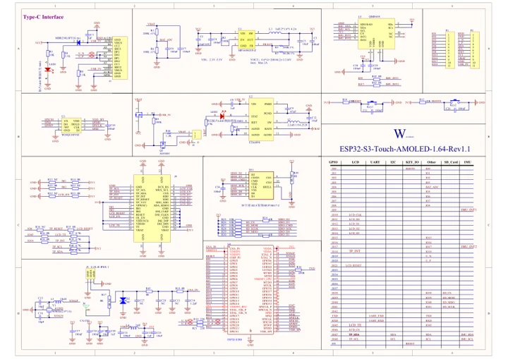
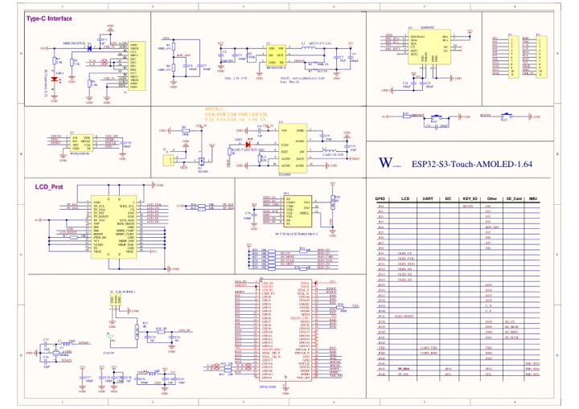

# ESP32-S3-Touch-AMOLED-1.64

**Waveshare** · ESP32-S3

Revision: Not identified

Coverage: Manufacturer references available; physical pinout and complete connector review are tracked separately

[Browse all manufacturers](../../../../BROWSE.md) · [Devices & IoT](../../../../DEVICES.md) · [Open in the browser guide](https://valleytech-black-wire-guide.pages.dev/?board=waveshare-esp32-esp32-s3-touch-amoled-1-64)

## Datasheets and original documentation

Board datasheet: **not yet recorded**. Visual reference: **available**.

[Manufacturer model documentation](https://docs.waveshare.com/ESP32-S3-Touch-AMOLED-1.64/Resources-And-Documents)

- **schematic / board**: [ESP32-S3-Touch-AMOLED-1.64 V1.1 Schematic — schematic](https://files.waveshare.com/wiki/ESP32-S3-Touch-AMOLED-1.64/ESP32-S3-Touch-AMOLED-1.64-Rev1.1.pdf) · [saved document](../../../../library/media/70345ca6e1b5385bcc362fa74ac8692a735648b8a4afa3377e2cc8599a03c14b.pdf)
- **schematic / board**: [ESP32-S3-Touch-AMOLED-1.64 V1 Schematic — schematic](https://files.waveshare.com/wiki/ESP32-S3-Touch-AMOLED-1.64/ESP32-S3-Touch-AMOLED-1.64-schematic.pdf) · [saved document](../../../../library/media/6cb2714b094efd5157a62681b82386b830d9ecc3c339bfdbe4c642768b0b8749.pdf)

A chip datasheet, schematic and board datasheet have different scopes. Match the exact hardware revision.

[Documentation coverage and remaining gaps](../../../../DOCUMENTATION.md)

## Pinout

**pinout image** · Reviewed source · JPG

[Open original reference](../../../../library/media/aeac7e022171cd4ece3f2ffc6c56dae08fa9efb2efab3c266adadd9694e34e08.jpg)

**Credit and rights:** Not recorded; retain original attribution. Source/manufacturer: Waveshare.

[Source 1](https://www.waveshare.com/img/devkit/ESP32-S3-Touch-AMOLED-1.64/ESP32-S3-Touch-AMOLED-1.64-details-inter.jpg) · [Source 2](https://www.waveshare.com/esp32-s3-touch-amoled-1.64.htm)

Image revision: Not identified

SHA-256: `aeac7e022171cd4ece3f2ffc6c56dae08fa9efb2efab3c266adadd9694e34e08`

## ESP32-S3-Touch-AMOLED-1.64 V1.1 Schematic — schematic

**reference PDF** · Source model/link and PDF signature/title checked; individual pin assignments and electrical validation pending · PDF

[Open original reference](../../../../library/media/70345ca6e1b5385bcc362fa74ac8692a735648b8a4afa3377e2cc8599a03c14b.pdf)

**Credit and rights:** Original publisher/manufacturer artwork; redistribution and print rights not established. Attribution is not a license grant.. Source/manufacturer: Waveshare.

[Source 1](https://files.waveshare.com/wiki/ESP32-S3-Touch-AMOLED-1.64/ESP32-S3-Touch-AMOLED-1.64-Rev1.1.pdf) · [Source 2](https://docs.waveshare.com/ESP32-S3-Touch-AMOLED-1.64/Resources-And-Documents)

Original document linked from this model’s manufacturer page. Preserve the document’s exact revision and named subassembly scope; a linked accessory schematic is not a whole-device pinout. This is a circuit schematic, not a physical board pinout.

Image revision: Use the revision printed in the original document; do not assume all hardware revisions are interchangeable

SHA-256: `70345ca6e1b5385bcc362fa74ac8692a735648b8a4afa3377e2cc8599a03c14b`

## ESP32-S3-Touch-AMOLED-1.64 V1 Schematic — schematic

**reference PDF** · Source model/link and PDF signature/title checked; individual pin assignments and electrical validation pending · PDF

[Open original reference](../../../../library/media/6cb2714b094efd5157a62681b82386b830d9ecc3c339bfdbe4c642768b0b8749.pdf)

**Credit and rights:** Original publisher/manufacturer artwork; redistribution and print rights not established. Attribution is not a license grant.. Source/manufacturer: Waveshare.

[Source 1](https://files.waveshare.com/wiki/ESP32-S3-Touch-AMOLED-1.64/ESP32-S3-Touch-AMOLED-1.64-schematic.pdf) · [Source 2](https://docs.waveshare.com/ESP32-S3-Touch-AMOLED-1.64/Resources-And-Documents)

Original document linked from this model’s manufacturer page. Preserve the document’s exact revision and named subassembly scope; a linked accessory schematic is not a whole-device pinout. This is a circuit schematic, not a physical board pinout.

Image revision: Use the revision printed in the original document; do not assume all hardware revisions are interchangeable

SHA-256: `6cb2714b094efd5157a62681b82386b830d9ecc3c339bfdbe4c642768b0b8749`

Pin assignments have not been independently electrically verified. Check board revision before wiring.
