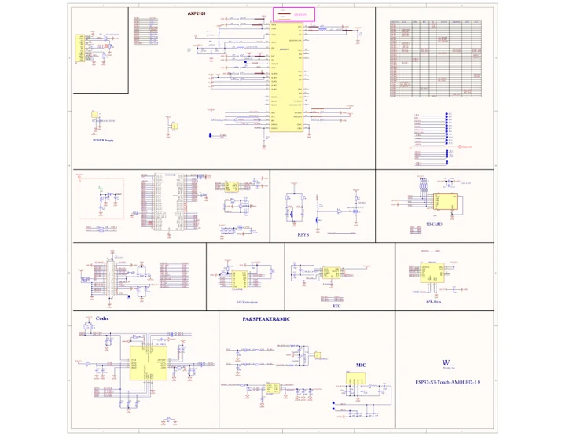

# ESP32-S3-Touch-AMOLED-1.8

**Waveshare** · ESP32-S3

Revision: Not identified

Coverage: Manufacturer references available; physical pinout and complete connector review are tracked separately

[Browse all manufacturers](../../../../BROWSE.md) · [Devices & IoT](../../../../DEVICES.md) · [Open in the browser guide](https://valleytech-black-wire-guide.pages.dev/?board=waveshare-esp32-esp32-s3-touch-amoled-1-8)

## Datasheets and original documentation

Board datasheet: **not yet recorded**. Visual reference: **available**.

[Manufacturer model documentation](https://www.waveshare.com/wiki/ESP32-S3-Touch-AMOLED-1.8)

- **schematic / board**: [ESP32-S3-Touch-AMOLED-1.8 Schematic diagram — schematic](https://files.waveshare.com/wiki/ESP32-S3-Touch-AMOLED-1.8/ESP32-S3-Touch-AMOLED-1.8.pdf) · [saved document](../../../../library/media/1a26267083a4d83665a9f1c73cf845dee6dda4f96dd03ff7f94bf2e60fc3c8ef.pdf)

A chip datasheet, schematic and board datasheet have different scopes. Match the exact hardware revision.

[Documentation coverage and remaining gaps](../../../../DOCUMENTATION.md)

## Pinout

**pinout image** · Reviewed source · JPG

[Open original reference](../../../../library/media/f4857cded4418d651fcce3d53b82443286458472b49886638e03d5f7eb7b896d.jpg)

**Credit and rights:** Not recorded; retain original attribution. Source/manufacturer: Waveshare.

[Source 1](https://www.waveshare.com/img/devkit/ESP32-S3-Touch-AMOLED-1.8/ESP32-S3-Touch-AMOLED-1.8-details-15.jpg) · [Source 2](https://www.waveshare.com/esp32-s3-touch-amoled-1.8.htm)

Image revision: Not identified

SHA-256: `f4857cded4418d651fcce3d53b82443286458472b49886638e03d5f7eb7b896d`

## Pinout

**pinout image** · Reviewed source · WEBP

[Open original reference](../../../../library/media/2f66b70063d76ca2a28cc61da6d55b36912ecfcf8a4e3594256ecca7030b8527.webp)

**Credit and rights:** Not recorded; retain original attribution. Source/manufacturer: Waveshare.

[Source 1](https://docs.waveshare.com/assets/images/ESP32-S3-Touch-AMOLED-1.8-details-15-29e01308259f0cbe05e3a0f866adcb5e.webp) · [Source 2](https://docs.waveshare.com/ESP32-S3-Touch-AMOLED-1.8)

Image revision: Not identified

SHA-256: `2f66b70063d76ca2a28cc61da6d55b36912ecfcf8a4e3594256ecca7030b8527`

## Pinout

**pinout image** · Reviewed source · JPG

[Open original reference](../../../../library/media/62fb28d705823f4b683560a921a2f9433c9c862f9df9b76744d7f724d09c963b.jpg)

**Credit and rights:** Not recorded; retain original attribution. Source/manufacturer: Waveshare.

[Source 1](https://www.waveshare.com/w/upload/2/2d/600px-ESP32-S3-Touch-AMOLED-1.8-details-15.jpg) · [Source 2](https://www.waveshare.com/wiki/ESP32-S3-Touch-AMOLED-1.8)

Image revision: Not identified

SHA-256: `62fb28d705823f4b683560a921a2f9433c9c862f9df9b76744d7f724d09c963b`

## ESP32-S3-Touch-AMOLED-1.8 Schematic diagram — schematic

**reference PDF** · Source model/link and PDF signature/title checked; individual pin assignments and electrical validation pending · PDF

[Open original reference](../../../../library/media/1a26267083a4d83665a9f1c73cf845dee6dda4f96dd03ff7f94bf2e60fc3c8ef.pdf)

**Credit and rights:** Original publisher/manufacturer artwork; redistribution and print rights not established. Attribution is not a license grant.. Source/manufacturer: Waveshare.

[Source 1](https://files.waveshare.com/wiki/ESP32-S3-Touch-AMOLED-1.8/ESP32-S3-Touch-AMOLED-1.8.pdf) · [Source 2](https://www.waveshare.com/wiki/ESP32-S3-Touch-AMOLED-1.8)

Original document linked from this model’s manufacturer page. Preserve the document’s exact revision and named subassembly scope; a linked accessory schematic is not a whole-device pinout. This is a circuit schematic, not a physical board pinout.

Image revision: Use the revision printed in the original document; do not assume all hardware revisions are interchangeable

SHA-256: `1a26267083a4d83665a9f1c73cf845dee6dda4f96dd03ff7f94bf2e60fc3c8ef`

Pin assignments have not been independently electrically verified. Check board revision before wiring.
