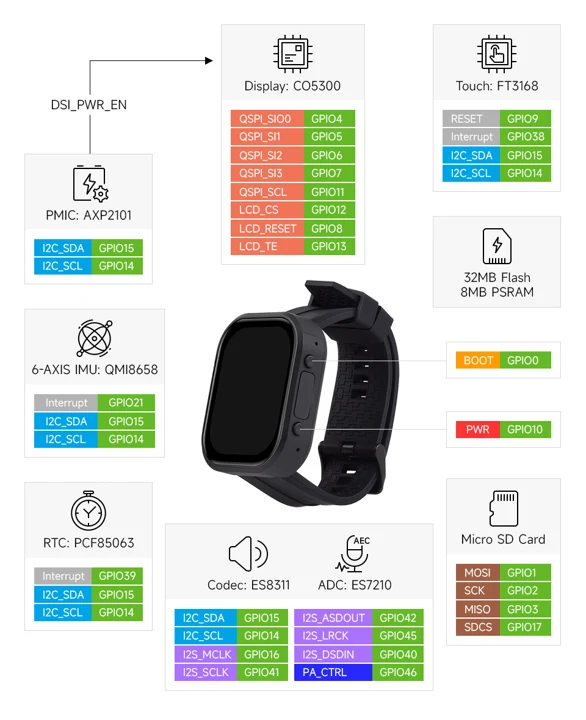

# ESP32-S3-Touch-AMOLED-2.06

**Waveshare** · ESP32-S3

Revision: Not identified

Coverage: Manufacturer references available; physical pinout and complete connector review are tracked separately

[Browse all manufacturers](../../../../BROWSE.md) · [Devices & IoT](../../../../DEVICES.md) · [Open in the browser guide](https://valleytech-black-wire-guide.pages.dev/?board=waveshare-esp32-esp32-s3-touch-amoled-2-06)

## Datasheets and original documentation

Board datasheet: **not yet recorded**. Visual reference: **available**.

[Manufacturer model documentation](https://www.waveshare.com/esp32-s3-touch-amoled-2.06.htm)

A chip datasheet, schematic and board datasheet have different scopes. Match the exact hardware revision.

[Documentation coverage and remaining gaps](../../../../DOCUMENTATION.md)

## GPIO peripheral assignments

**GPIO reference image** · Reviewed source · WEBP

[Open original reference](../../../../library/media/be8aedc41129a5e5352587632bf75aa85204e334e27f0acd64851650b443a0ef.webp)

**Credit and rights:** Not established; source attribution retained. Source/manufacturer: Waveshare.

[Source 1](https://docs.waveshare.com/assets/images/ESP32-S3-Touch-AMOLED-2.06-details-inter-41ffaa4cd3c631aa34ca153e4e4778b6.webp) · [Source 2](https://docs.waveshare.com/ESP32-S3-Touch-AMOLED-2.06)

Official reference image. This is useful for board peripherals but must not be treated as a physical header/pad pinout. Board remains in the pinout research queue.

Image revision: Not identified

SHA-256: `be8aedc41129a5e5352587632bf75aa85204e334e27f0acd64851650b443a0ef`

## ESP32-S3-Touch-AMOLED-2.06 peripheral assignments

**GPIO reference image** · Visually reviewed for identity and reference scope; independent electrical review pending · JPG

[Open original reference](../../../../library/media/bddcfe65438f21cbd5b560dabefe51f48866fd62cebfa63de656dc067221b161.jpg)

**Credit and rights:** Original publisher/manufacturer artwork; redistribution and print rights not established. Attribution is not a license grant.. Source/manufacturer: Waveshare.

[Source 1](https://www.waveshare.com/img/devkit/ESP32-S3-Touch-AMOLED-2.06/ESP32-S3-Touch-AMOLED-2.06-details-inter.jpg?v=26050702) · [Source 2](https://www.waveshare.com/esp32-s3-touch-amoled-2.06.htm)

Function/block diagram, not a complete physical connector pinout.

Image revision: Use the revision printed in the original document; do not assume all hardware revisions are interchangeable

SHA-256: `bddcfe65438f21cbd5b560dabefe51f48866fd62cebfa63de656dc067221b161`

Pin assignments have not been independently electrically verified. Check board revision before wiring.
