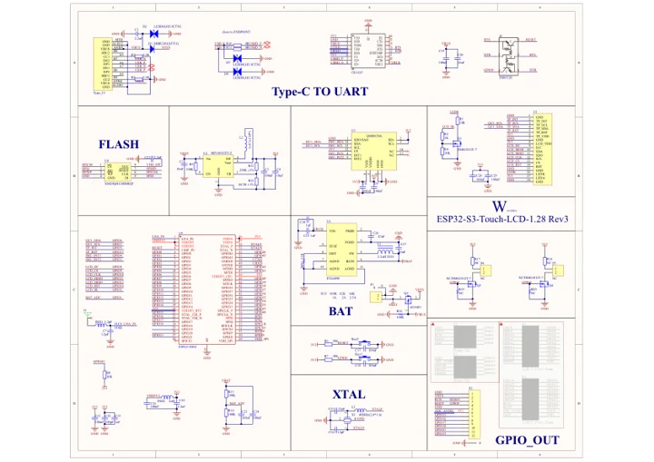
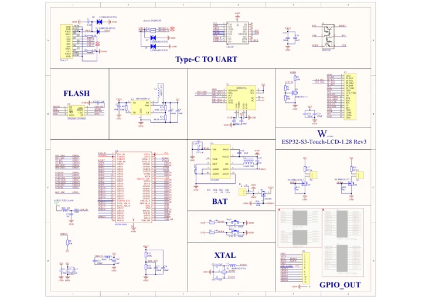

# ESP32-S3-Touch-LCD-1.28

**Waveshare** · ESP32-S3

Revision: Not identified

Coverage: Manufacturer references available; physical pinout and complete connector review are tracked separately

[Browse all manufacturers](../../../../BROWSE.md) · [Devices & IoT](../../../../DEVICES.md) · [Open in the browser guide](https://valleytech-black-wire-guide.pages.dev/?board=waveshare-esp32-esp32-s3-touch-lcd-1-28)

## Datasheets and original documentation

Board datasheet: **not yet recorded**. Visual reference: **available**.

[Manufacturer model documentation](https://docs.waveshare.com/ESP32-S3-Touch-LCD-1.28/Resources-And-Documents)

- **schematic / board**: [Schematic — schematic](https://files.waveshare.com/wiki/ESP32-S3-Touch-LCD-1.28/ESP32-S3-Touch-LCD-1.28-Sch.pdf) · [saved document](../../../../library/media/6001fdb2c4d78322b83bcc06621ac10df32d1a20b38198f16a84f8440b58a56e.pdf)
- **schematic / board**: [ESP32-S3-Touch-LCD-1.28 Rev3 Schematic — schematic](https://files.waveshare.com/wiki/ESP32-S3-Touch-LCD-1.28/ESP32-S3-Touch-LCD-1.28_Rev3.pdf) · [saved document](../../../../library/media/0e146bf619920d74bbebd5296c1152cc875b0a27b9d7d203c3f0cf7afcc7e1eb.pdf)

A chip datasheet, schematic and board datasheet have different scopes. Match the exact hardware revision.

[Documentation coverage and remaining gaps](../../../../DOCUMENTATION.md)

## Pinout

**pinout image** · Reviewed source · JPG

[Open original reference](../../../../library/media/b36e2830faa5dfb5dc0b3644348432f20d98c91d775c84fc550721fb4beebf0f.jpg)

**Credit and rights:** Not recorded; retain original attribution. Source/manufacturer: Waveshare.

[Source 1](https://www.waveshare.com/img/devkit/ESP32-S3-Touch-LCD-1.28/ESP32-S3-Touch-LCD-1.28-details-inter.jpg) · [Source 2](https://www.waveshare.com/esp32-s3-touch-lcd-1.28.htm) · [Source 3](https://www.waveshare.com/esp32-s3-touch-lcd-1.28-b.htm)

Image revision: Not identified

SHA-256: `b36e2830faa5dfb5dc0b3644348432f20d98c91d775c84fc550721fb4beebf0f`

## Pinout

**pinout image** · Reviewed source · WEBP

[Open original reference](../../../../library/media/6479f0a1964662a4a4ebdcd03e78e898a80fb453063d23ca550fcb80598f8554.webp)

**Credit and rights:** Not recorded; retain original attribution. Source/manufacturer: Waveshare.

[Source 1](https://docs.waveshare.com/assets/images/Esp32-s3-touch-lcd-1.28-003-c7bcf4bd1440b55a43abb060ad67d705.webp) · [Source 2](https://docs.waveshare.com/ESP32-S3-Touch-LCD-1.28)

Image revision: Not identified

SHA-256: `6479f0a1964662a4a4ebdcd03e78e898a80fb453063d23ca550fcb80598f8554`

## Pinout

**pinout image** · Reviewed source · PNG

[Open original reference](../../../../library/media/4cced2fdc4c663cfcd4ace0752962dca3260f9948f34188150ce96fd7f39e7be.png)

**Credit and rights:** Not recorded; retain original attribution. Source/manufacturer: Waveshare.

[Source 1](https://www.waveshare.com/w/upload/d/d5/Esp32-s3-touch-lcd-1.28-003.png) · [Source 2](https://www.waveshare.com/wiki/ESP32-S3-Touch-LCD-1.28)

Image revision: Not identified

SHA-256: `4cced2fdc4c663cfcd4ace0752962dca3260f9948f34188150ce96fd7f39e7be`

## Schematic — schematic

**reference PDF** · Source model/link and PDF signature/title checked; individual pin assignments and electrical validation pending · PDF

[Open original reference](../../../../library/media/6001fdb2c4d78322b83bcc06621ac10df32d1a20b38198f16a84f8440b58a56e.pdf)

**Credit and rights:** Original publisher/manufacturer artwork; redistribution and print rights not established. Attribution is not a license grant.. Source/manufacturer: Waveshare.

[Source 1](https://files.waveshare.com/wiki/ESP32-S3-Touch-LCD-1.28/ESP32-S3-Touch-LCD-1.28-Sch.pdf) · [Source 2](https://docs.waveshare.com/ESP32-S3-Touch-LCD-1.28)

Original document linked from this model’s manufacturer page. Preserve the document’s exact revision and named subassembly scope; a linked accessory schematic is not a whole-device pinout. This is a circuit schematic, not a physical board pinout.

Image revision: Use the revision printed in the original document; do not assume all hardware revisions are interchangeable

SHA-256: `6001fdb2c4d78322b83bcc06621ac10df32d1a20b38198f16a84f8440b58a56e`

## ESP32-S3-Touch-LCD-1.28 Rev3 Schematic — schematic

**reference PDF** · Source model/link and PDF signature/title checked; individual pin assignments and electrical validation pending · PDF

[Open original reference](../../../../library/media/0e146bf619920d74bbebd5296c1152cc875b0a27b9d7d203c3f0cf7afcc7e1eb.pdf)

**Credit and rights:** Original publisher/manufacturer artwork; redistribution and print rights not established. Attribution is not a license grant.. Source/manufacturer: Waveshare.

[Source 1](https://files.waveshare.com/wiki/ESP32-S3-Touch-LCD-1.28/ESP32-S3-Touch-LCD-1.28_Rev3.pdf) · [Source 2](https://docs.waveshare.com/ESP32-S3-Touch-LCD-1.28/Resources-And-Documents)

Original document linked from this model’s manufacturer page. Preserve the document’s exact revision and named subassembly scope; a linked accessory schematic is not a whole-device pinout. This is a circuit schematic, not a physical board pinout.

Image revision: Use the revision printed in the original document; do not assume all hardware revisions are interchangeable

SHA-256: `0e146bf619920d74bbebd5296c1152cc875b0a27b9d7d203c3f0cf7afcc7e1eb`

Pin assignments have not been independently electrically verified. Check board revision before wiring.
