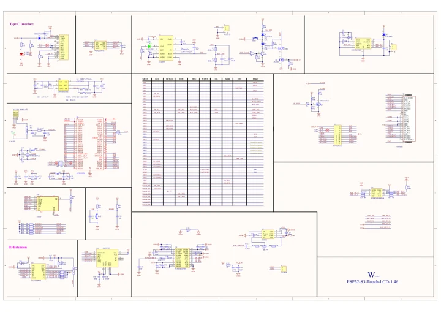

# ESP32-S3-Touch-LCD-1.46B

**Waveshare** · ESP32-S3

Revision: Not identified

Coverage: Manufacturer references available; physical pinout and complete connector review are tracked separately

[Browse all manufacturers](../../../../BROWSE.md) · [Devices & IoT](../../../../DEVICES.md) · [Open in the browser guide](https://valleytech-black-wire-guide.pages.dev/?board=waveshare-esp32-esp32-s3-touch-lcd-1-46b)

## Datasheets and original documentation

Board datasheet: **not yet recorded**. Visual reference: **available**.

[Manufacturer model documentation](https://www.waveshare.com/wiki/ESP32-S3-Touch-LCD-1.46B)

- **schematic / board**: [ESP32-S3-Touch-LCD-1.46 Schematic diagram — schematic](https://files.waveshare.com/wiki/ESP32-S3-Touch-LCD-1.46/ESP32-S3-Touch-LCD-1.46.pdf) · [saved document](../../../../library/media/aa82913fc7099bc066994865b4a6bd17a2eb430a574e1fbbf9af472a91c92e2b.pdf)

A chip datasheet, schematic and board datasheet have different scopes. Match the exact hardware revision.

[Documentation coverage and remaining gaps](../../../../DOCUMENTATION.md)

## Pinout

**pinout image** · Reviewed source · JPG

[Open original reference](../../../../library/media/bc1636424d8af076f46fb9369e831ffb17d6cb3bd41dfd23750e323945357d55.jpg)

**Credit and rights:** Not recorded; retain original attribution. Source/manufacturer: Waveshare.

[Source 1](https://www.waveshare.com/img/devkit/ESP32-S3-Touch-LCD-1.46B/ESP32-S3-Touch-LCD-1.46B-details-intro.jpg) · [Source 2](https://www.waveshare.com/esp32-s3-touch-lcd-1.46b.htm)

Image revision: Not identified

SHA-256: `bc1636424d8af076f46fb9369e831ffb17d6cb3bd41dfd23750e323945357d55`

## Pinout

**pinout image** · Reviewed source · JPG

[Open original reference](../../../../library/media/3f8e5ba5b4e6e914a248db6bc9ed8a05cd4fb75ba3ce59bb152d0540aa7374df.jpg)

**Credit and rights:** Not recorded; retain original attribution. Source/manufacturer: Waveshare.

[Source 1](https://www.waveshare.com/w/upload/7/72/600px-ESP32-S3-Touch-LCD-1.46-introduction-02_1.jpg) · [Source 2](https://www.waveshare.com/wiki/ESP32-S3-Touch-LCD-1.46B)

Image revision: Not identified

SHA-256: `3f8e5ba5b4e6e914a248db6bc9ed8a05cd4fb75ba3ce59bb152d0540aa7374df`

## ESP32-S3-Touch-LCD-1.46 Schematic diagram — schematic

**reference PDF** · Source model/link and PDF signature/title checked; individual pin assignments and electrical validation pending · PDF

[Open original reference](../../../../library/media/aa82913fc7099bc066994865b4a6bd17a2eb430a574e1fbbf9af472a91c92e2b.pdf)

**Credit and rights:** Original publisher/manufacturer artwork; redistribution and print rights not established. Attribution is not a license grant.. Source/manufacturer: Waveshare.

[Source 1](https://files.waveshare.com/wiki/ESP32-S3-Touch-LCD-1.46/ESP32-S3-Touch-LCD-1.46.pdf) · [Source 2](https://www.waveshare.com/wiki/ESP32-S3-Touch-LCD-1.46B)

Original document linked from this model’s manufacturer page. Preserve the document’s exact revision and named subassembly scope; a linked accessory schematic is not a whole-device pinout. This is a circuit schematic, not a physical board pinout.

Image revision: Use the revision printed in the original document; do not assume all hardware revisions are interchangeable

SHA-256: `aa82913fc7099bc066994865b4a6bd17a2eb430a574e1fbbf9af472a91c92e2b`

Pin assignments have not been independently electrically verified. Check board revision before wiring.
