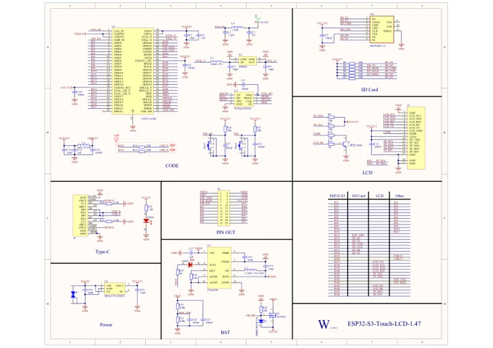

# ESP32-S3-Touch-LCD-1.47

**Waveshare** · ESP32-S3

Revision: Not identified

Coverage: Manufacturer references available; physical pinout and complete connector review are tracked separately

[Browse all manufacturers](../../../../BROWSE.md) · [Devices & IoT](../../../../DEVICES.md) · [Open in the browser guide](https://valleytech-black-wire-guide.pages.dev/?board=waveshare-esp32-esp32-s3-touch-lcd-1-47)

## Datasheets and original documentation

Board datasheet: **not yet recorded**. Visual reference: **available**.

[Manufacturer model documentation](https://docs.waveshare.com/ESP32-S3-Touch-LCD-1.47/Resources-And-Documents)

- **schematic / board**: [ESP32-S3-Touch-LCD-1.47 Schematic Diagram — schematic](https://files.waveshare.com/wiki/ESP32-S3-Touch-LCD-1.47/ESP32-S3-Touch-LCD-1.47-Schematic.pdf) · [saved document](../../../../library/media/db1f05c28bbd078e76b430ff2a1332fe7e566731104756a73c84f08c38333ae5.pdf)

A chip datasheet, schematic and board datasheet have different scopes. Match the exact hardware revision.

[Documentation coverage and remaining gaps](../../../../DOCUMENTATION.md)

## Pinout

**pinout image** · Reviewed source · JPG

[Open original reference](../../../../library/media/4797b6d6af810575a5cd1a6a8daafeb9a52395409c29b5edea520fa0f34031ff.jpg)

**Credit and rights:** Not recorded; retain original attribution. Source/manufacturer: Waveshare.

[Source 1](https://www.waveshare.com/img/devkit/ESP32-S3-Touch-LCD-1.47/ESP32-S3-Touch-LCD-1.47-details-inter.jpg) · [Source 2](https://www.waveshare.com/esp32-s3-touch-lcd-1.47.htm)

Image revision: Not identified

SHA-256: `4797b6d6af810575a5cd1a6a8daafeb9a52395409c29b5edea520fa0f34031ff`

## Pinout

**pinout image** · Reviewed source · WEBP

[Open original reference](../../../../library/media/90df831afe9a82ff66ad4955e670321d53d3f9a1a7a77dd222cb3018ba6a9fa3.webp)

**Credit and rights:** Not recorded; retain original attribution. Source/manufacturer: Waveshare.

[Source 1](https://docs.waveshare.com/assets/images/ESP32-S3-Touch-LCD-1.47-details-inter-f60fcf8e6f1405b29f83509d1d1246e7.webp) · [Source 2](https://docs.waveshare.com/ESP32-S3-Touch-LCD-1.47)

Image revision: Not identified

SHA-256: `90df831afe9a82ff66ad4955e670321d53d3f9a1a7a77dd222cb3018ba6a9fa3`

## Pinout

**pinout image** · Reviewed source · JPG

[Open original reference](../../../../library/media/471a6a3b2cccbe2cd5ea085ef2c2d21d5a0396e9b9db76e40139b0cbddbe108a.jpg)

**Credit and rights:** Not recorded; retain original attribution. Source/manufacturer: Waveshare.

[Source 1](https://www.waveshare.com/w/upload/3/3f/ESP32-S3-Touch-LCD-1.47-details-inter.jpg) · [Source 2](https://www.waveshare.com/wiki/ESP32-S3-Touch-LCD-1.47)

Image revision: Not identified

SHA-256: `471a6a3b2cccbe2cd5ea085ef2c2d21d5a0396e9b9db76e40139b0cbddbe108a`

## ESP32-S3-Touch-LCD-1.47 Schematic Diagram — schematic

**reference PDF** · Source model/link and PDF signature/title checked; individual pin assignments and electrical validation pending · PDF

[Open original reference](../../../../library/media/db1f05c28bbd078e76b430ff2a1332fe7e566731104756a73c84f08c38333ae5.pdf)

**Credit and rights:** Original publisher/manufacturer artwork; redistribution and print rights not established. Attribution is not a license grant.. Source/manufacturer: Waveshare.

[Source 1](https://files.waveshare.com/wiki/ESP32-S3-Touch-LCD-1.47/ESP32-S3-Touch-LCD-1.47-Schematic.pdf) · [Source 2](https://docs.waveshare.com/ESP32-S3-Touch-LCD-1.47/Resources-And-Documents)

Original document linked from this model’s manufacturer page. Preserve the document’s exact revision and named subassembly scope; a linked accessory schematic is not a whole-device pinout. This is a circuit schematic, not a physical board pinout.

Image revision: Use the revision printed in the original document; do not assume all hardware revisions are interchangeable

SHA-256: `db1f05c28bbd078e76b430ff2a1332fe7e566731104756a73c84f08c38333ae5`

Pin assignments have not been independently electrically verified. Check board revision before wiring.
