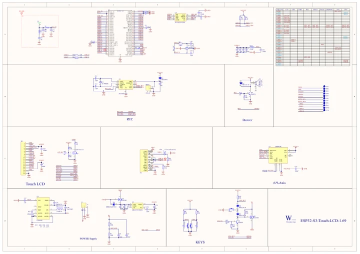

# ESP32-S3-Touch-LCD-1.69

**Waveshare** · ESP32-S3

Revision: Not identified

Coverage: Manufacturer references available; physical pinout and complete connector review are tracked separately

[Browse all manufacturers](../../../../BROWSE.md) · [Devices & IoT](../../../../DEVICES.md) · [Open in the browser guide](https://valleytech-black-wire-guide.pages.dev/?board=waveshare-esp32-esp32-s3-touch-lcd-1-69)

## Datasheets and original documentation

Board datasheet: **not yet recorded**. Visual reference: **available**.

[Manufacturer model documentation](https://docs.waveshare.com/ESP32-S3-Touch-LCD-1.69/Resources-And-Documents)

- **schematic / board**: [ESP32-S3-Touch-LCD-1.69 Schematic — schematic](https://github.com/waveshareteam/ESP32-S3-Touch-LCD-1.69/raw/main/hardware/schematics/ESP32-S3-Touch-LCD-1.69.pdf) · [saved document](../../../../library/media/474d5b4ea07537e61d230596fc786329f9040d691521b19f4e36d24c97c3240a.pdf)

A chip datasheet, schematic and board datasheet have different scopes. Match the exact hardware revision.

[Documentation coverage and remaining gaps](../../../../DOCUMENTATION.md)

## Pinout

**pinout image** · Reviewed source · JPG

[Open original reference](../../../../library/media/fac684b28b567eb410083a6237ebdcb1632f769276441ed412df68785ad2375d.jpg)

**Credit and rights:** Not recorded; retain original attribution. Source/manufacturer: Waveshare.

[Source 1](https://www.waveshare.com/img/devkit/ESP32-S3-Touch-LCD-1.69/ESP32-S3-Touch-LCD-1.69-details-5.jpg) · [Source 2](https://www.waveshare.com/esp32-s3-touch-lcd-1.69.htm)

Image revision: Not identified

SHA-256: `fac684b28b567eb410083a6237ebdcb1632f769276441ed412df68785ad2375d`

## Pinout

**pinout image** · Reviewed source · WEBP

[Open original reference](../../../../library/media/bc1aa52d0d24ca30228a1b4579732972ba14520999900a94416be64e8ec10442.webp)

**Credit and rights:** Not recorded; retain original attribution. Source/manufacturer: Waveshare.

[Source 1](https://docs.waveshare.com/assets/images/ESP32-S3-Touch-LCD-1.69-Pinout-9eb7123eddd52dc51577bba392a34e65.webp) · [Source 2](https://docs.waveshare.com/ESP32-S3-Touch-LCD-1.69)

Image revision: Not identified

SHA-256: `bc1aa52d0d24ca30228a1b4579732972ba14520999900a94416be64e8ec10442`

## Pinout

**pinout image** · Reviewed source · JPG

[Open original reference](../../../../library/media/219bfc83c35bf0a6b91fb2577d84f0de89792ca7e15dbd0c12903a4437ccd3a2.jpg)

**Credit and rights:** Not recorded; retain original attribution. Source/manufacturer: Waveshare.

[Source 1](https://www.waveshare.com/w/upload/d/dd/ESP32-S3-Touch-LCD-1.69-details-5.jpg) · [Source 2](https://www.waveshare.com/wiki/ESP32-S3-Touch-LCD-1.69)

Image revision: Not identified

SHA-256: `219bfc83c35bf0a6b91fb2577d84f0de89792ca7e15dbd0c12903a4437ccd3a2`

## ESP32-S3-Touch-LCD-1.69 Schematic — schematic

**reference PDF** · Source model/link and PDF signature/title checked; individual pin assignments and electrical validation pending · PDF

[Open original reference](../../../../library/media/474d5b4ea07537e61d230596fc786329f9040d691521b19f4e36d24c97c3240a.pdf)

**Credit and rights:** Original publisher/manufacturer artwork; redistribution and print rights not established. Attribution is not a license grant.. Source/manufacturer: Waveshare.

[Source 1](https://github.com/waveshareteam/ESP32-S3-Touch-LCD-1.69/raw/main/hardware/schematics/ESP32-S3-Touch-LCD-1.69.pdf) · [Source 2](https://docs.waveshare.com/ESP32-S3-Touch-LCD-1.69/Resources-And-Documents)

Original document linked from this model’s manufacturer page. Preserve the document’s exact revision and named subassembly scope; a linked accessory schematic is not a whole-device pinout. This is a circuit schematic, not a physical board pinout.

Image revision: Use the revision printed in the original document; do not assume all hardware revisions are interchangeable

SHA-256: `474d5b4ea07537e61d230596fc786329f9040d691521b19f4e36d24c97c3240a`

Pin assignments have not been independently electrically verified. Check board revision before wiring.
