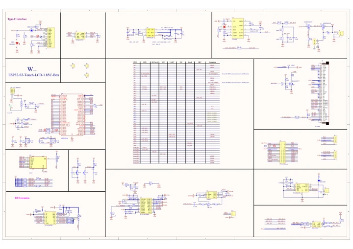
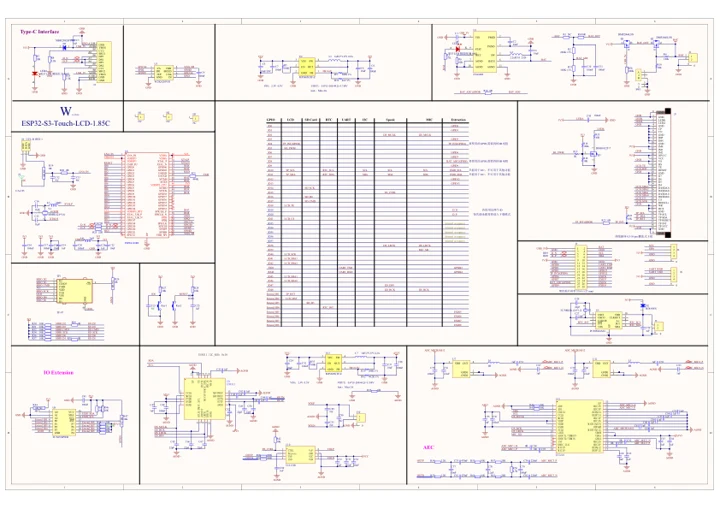

# ESP32-S3-Touch-LCD-1.85

**Waveshare** · ESP32-S3

Revision: Not identified

Coverage: Manufacturer references available; physical pinout and complete connector review are tracked separately

[Browse all manufacturers](../../../../BROWSE.md) · [Devices & IoT](../../../../DEVICES.md) · [Open in the browser guide](https://valleytech-black-wire-guide.pages.dev/?board=waveshare-esp32-esp32-s3-touch-lcd-1-85)

## Datasheets and original documentation

Board datasheet: **not yet recorded**. Visual reference: **available**.

[Manufacturer model documentation](https://docs.waveshare.com/ESP32-S3-Touch-LCD-1.85C/Resources-And-Documents)

- **schematic / board**: [ESP32-S3-Touch-LCD-1.85 Schematic — schematic](https://files.waveshare.com/wiki/ESP32-S3-Touch-LCD-1.85/ESP32-S3-Touch-LCD-1.85.pdf) · [saved document](../../../../library/media/2ed85afc5a9368ebfd17185fa220976075c876cea5ab65c95fa30783dfc9b03f.pdf)
- **schematic / board**: [ESP32-S3-Touch-LCD-1.85C V1 Schematic — schematic](https://files.waveshare.com/wiki/ESP32-S3-Touch-LCD-1.85C/ESP32-S3-Touch-LCD-1.85C-Schematic.pdf) · [saved document](../../../../library/media/13ab1b27514e12b67b5f9a8357c7604285e201e89260973bc2365d1da2744dc7.pdf)
- **schematic / board**: [ESP32-S3-Touch-LCD-1.85C V2 Schematic — schematic](https://files.waveshare.com/wiki/ESP32-S3-Touch-LCD-1.85C/ESP32-S3-Touch-LCD-1.85C_V2.pdf) · [saved document](../../../../library/media/88f11c93958fbda384ef7bf825924c4b8cd663052bd37c215f2f9a053c981c3a.pdf)

A chip datasheet, schematic and board datasheet have different scopes. Match the exact hardware revision.

[Documentation coverage and remaining gaps](../../../../DOCUMENTATION.md)

## Pinout

**pinout image** · Reviewed source · JPG

[Open original reference](../../../../library/media/c0dfa8b1d8a14096f40d0a205f32f53407684b440a0897f75f0f6a0748196925.jpg)

**Credit and rights:** Not recorded; retain original attribution. Source/manufacturer: Waveshare.

[Source 1](https://www.waveshare.com/img/devkit/ESP32-S3-Touch-LCD-1.85/ESP32-S3-Touch-LCD-1.85-details-9.jpg) · [Source 2](https://www.waveshare.com/esp32-s3-touch-lcd-1.85.htm)

Image revision: Not identified

SHA-256: `c0dfa8b1d8a14096f40d0a205f32f53407684b440a0897f75f0f6a0748196925`

## Pinout

**pinout image** · Reviewed source · WEBP

[Open original reference](../../../../library/media/b3ddd8821f9765798c71cf71e6779568d4034c4ea537f61d3a527476a3463a71.webp)

**Credit and rights:** Not recorded; retain original attribution. Source/manufacturer: Waveshare.

[Source 1](https://docs.waveshare.com/assets/images/ESP32-S3-Touch-LCD-1.85-introduction-02-133ade067dfefefd63f2e400a45d68d2.webp) · [Source 2](https://docs.waveshare.com/ESP32-S3-Touch-LCD-1.85) · [Source 3](https://docs.waveshare.com/ESP32-S3-Touch-LCD-1.85C)

Image revision: Not identified

SHA-256: `b3ddd8821f9765798c71cf71e6779568d4034c4ea537f61d3a527476a3463a71`

## ESP32-S3-Touch-LCD-1.85 Schematic — schematic

**reference PDF** · Source model/link and PDF signature/title checked; individual pin assignments and electrical validation pending · PDF

[Open original reference](../../../../library/media/2ed85afc5a9368ebfd17185fa220976075c876cea5ab65c95fa30783dfc9b03f.pdf)

**Credit and rights:** Original publisher/manufacturer artwork; redistribution and print rights not established. Attribution is not a license grant.. Source/manufacturer: Waveshare.

[Source 1](https://files.waveshare.com/wiki/ESP32-S3-Touch-LCD-1.85/ESP32-S3-Touch-LCD-1.85.pdf) · [Source 2](https://docs.waveshare.com/ESP32-S3-Touch-LCD-1.85/Resources-And-Documents)

Original document linked from this model’s manufacturer page. Preserve the document’s exact revision and named subassembly scope; a linked accessory schematic is not a whole-device pinout. This is a circuit schematic, not a physical board pinout.

Image revision: Use the revision printed in the original document; do not assume all hardware revisions are interchangeable

SHA-256: `2ed85afc5a9368ebfd17185fa220976075c876cea5ab65c95fa30783dfc9b03f`

## ESP32-S3-Touch-LCD-1.85C V1 Schematic — schematic

**reference PDF** · Source model/link and PDF signature/title checked; individual pin assignments and electrical validation pending · PDF

[Open original reference](../../../../library/media/13ab1b27514e12b67b5f9a8357c7604285e201e89260973bc2365d1da2744dc7.pdf)

**Credit and rights:** Original publisher/manufacturer artwork; redistribution and print rights not established. Attribution is not a license grant.. Source/manufacturer: Waveshare.

[Source 1](https://files.waveshare.com/wiki/ESP32-S3-Touch-LCD-1.85C/ESP32-S3-Touch-LCD-1.85C-Schematic.pdf) · [Source 2](https://docs.waveshare.com/ESP32-S3-Touch-LCD-1.85C/Resources-And-Documents)

Original document linked from this model’s manufacturer page. Preserve the document’s exact revision and named subassembly scope; a linked accessory schematic is not a whole-device pinout. This is a circuit schematic, not a physical board pinout.

Image revision: Use the revision printed in the original document; do not assume all hardware revisions are interchangeable

SHA-256: `13ab1b27514e12b67b5f9a8357c7604285e201e89260973bc2365d1da2744dc7`

## ESP32-S3-Touch-LCD-1.85C V2 Schematic — schematic

**reference PDF** · Source model/link and PDF signature/title checked; individual pin assignments and electrical validation pending · PDF

[Open original reference](../../../../library/media/88f11c93958fbda384ef7bf825924c4b8cd663052bd37c215f2f9a053c981c3a.pdf)

**Credit and rights:** Original publisher/manufacturer artwork; redistribution and print rights not established. Attribution is not a license grant.. Source/manufacturer: Waveshare.

[Source 1](https://files.waveshare.com/wiki/ESP32-S3-Touch-LCD-1.85C/ESP32-S3-Touch-LCD-1.85C_V2.pdf) · [Source 2](https://docs.waveshare.com/ESP32-S3-Touch-LCD-1.85C/Resources-And-Documents)

Original document linked from this model’s manufacturer page. Preserve the document’s exact revision and named subassembly scope; a linked accessory schematic is not a whole-device pinout. This is a circuit schematic, not a physical board pinout.

Image revision: Use the revision printed in the original document; do not assume all hardware revisions are interchangeable

SHA-256: `88f11c93958fbda384ef7bf825924c4b8cd663052bd37c215f2f9a053c981c3a`

Pin assignments have not been independently electrically verified. Check board revision before wiring.
