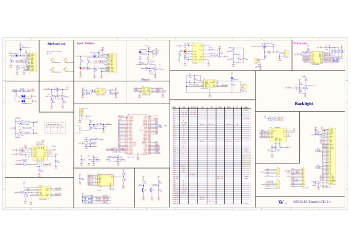

# ESP32-S3-Touch-LCD-2.1

**Waveshare** · ESP32-S3

Revision: Not identified

Coverage: Manufacturer references available; physical pinout and complete connector review are tracked separately

[Browse all manufacturers](../../../../BROWSE.md) · [Devices & IoT](../../../../DEVICES.md) · [Open in the browser guide](https://valleytech-black-wire-guide.pages.dev/?board=waveshare-esp32-esp32-s3-touch-lcd-2-1)

## Datasheets and original documentation

Board datasheet: **not yet recorded**. Visual reference: **available**.

[Manufacturer model documentation](https://docs.waveshare.com/ESP32-S3-Touch-LCD-2.1/Resources-And-Documents)

- **schematic / board**: [ESP32-S3-Touch-LCD-2.1 Schematic — schematic](https://files.waveshare.com/wiki/ESP32-S3-Touch-LCD-2.1/ESP32-S3-Touch-LCD-2.1_schematic_diagram.pdf) · [saved document](../../../../library/media/135e420413b5f00adc2a62c1ab69b76b90e0fc900313278e4017cbb70290d08c.pdf)

A chip datasheet, schematic and board datasheet have different scopes. Match the exact hardware revision.

[Documentation coverage and remaining gaps](../../../../DOCUMENTATION.md)

## Pinout

**pinout image** · Reviewed source · JPG

[Open original reference](../../../../library/media/1d171eaaee82e461152c70b7b4be2e09a64dc88bd29fd7b9d3619d53802b006f.jpg)

**Credit and rights:** Not recorded; retain original attribution. Source/manufacturer: Waveshare.

[Source 1](https://www.waveshare.com/img/devkit/ESP32-S3-Touch-LCD-2.1/ESP32-S3-Touch-LCD-2.1-details-7.jpg) · [Source 2](https://www.waveshare.com/esp32-s3-touch-lcd-2.1.htm)

Image revision: Not identified

SHA-256: `1d171eaaee82e461152c70b7b4be2e09a64dc88bd29fd7b9d3619d53802b006f`

## Pinout

**pinout image** · Reviewed source · WEBP

[Open original reference](../../../../library/media/ecedefddfbecb229010e09320a39cc672bf2a624764c0c5a5a7d81844c561802.webp)

**Credit and rights:** Not recorded; retain original attribution. Source/manufacturer: Waveshare.

[Source 1](https://docs.waveshare.com/assets/images/ESP32-S3-Touch-LCD-2.1-Interface-a320a8256931ce1213f30e0c645fcf22.webp) · [Source 2](https://docs.waveshare.com/ESP32-S3-Touch-LCD-2.1)

Image revision: Not identified

SHA-256: `ecedefddfbecb229010e09320a39cc672bf2a624764c0c5a5a7d81844c561802`

## Pinout

**pinout image** · Reviewed source · PNG

[Open original reference](../../../../library/media/35f1a6ab777634321597c2b14e0301c2e5e5a7f8c7e6beb382a6b5c929154d89.png)

**Credit and rights:** Not recorded; retain original attribution. Source/manufacturer: Waveshare.

[Source 1](https://www.waveshare.com/w/upload/a/aa/ESP32-S3-Touch-LCD-2.1-introduction-02.png) · [Source 2](https://www.waveshare.com/wiki/ESP32-S3-Touch-LCD-2.1)

Image revision: Not identified

SHA-256: `35f1a6ab777634321597c2b14e0301c2e5e5a7f8c7e6beb382a6b5c929154d89`

## ESP32-S3-Touch-LCD-2.1 Schematic — schematic

**reference PDF** · Source model/link and PDF signature/title checked; individual pin assignments and electrical validation pending · PDF

[Open original reference](../../../../library/media/135e420413b5f00adc2a62c1ab69b76b90e0fc900313278e4017cbb70290d08c.pdf)

**Credit and rights:** Original publisher/manufacturer artwork; redistribution and print rights not established. Attribution is not a license grant.. Source/manufacturer: Waveshare.

[Source 1](https://files.waveshare.com/wiki/ESP32-S3-Touch-LCD-2.1/ESP32-S3-Touch-LCD-2.1_schematic_diagram.pdf) · [Source 2](https://docs.waveshare.com/ESP32-S3-Touch-LCD-2.1/Resources-And-Documents)

Original document linked from this model’s manufacturer page. Preserve the document’s exact revision and named subassembly scope; a linked accessory schematic is not a whole-device pinout. This is a circuit schematic, not a physical board pinout.

Image revision: Use the revision printed in the original document; do not assume all hardware revisions are interchangeable

SHA-256: `135e420413b5f00adc2a62c1ab69b76b90e0fc900313278e4017cbb70290d08c`

Pin assignments have not been independently electrically verified. Check board revision before wiring.
