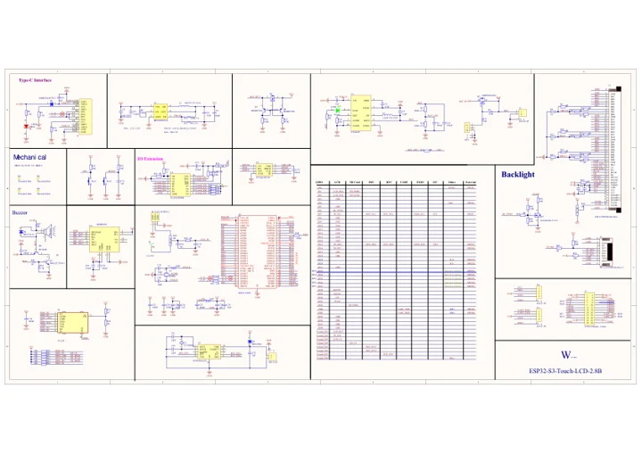

# ESP32-S3-Touch-LCD-2.8B

**Waveshare** · ESP32-S3

Revision: Not identified

Coverage: Manufacturer references available; physical pinout and complete connector review are tracked separately

[Browse all manufacturers](../../../../BROWSE.md) · [Devices & IoT](../../../../DEVICES.md) · [Open in the browser guide](https://valleytech-black-wire-guide.pages.dev/?board=waveshare-esp32-esp32-s3-touch-lcd-2-8b)

## Datasheets and original documentation

Board datasheet: **not yet recorded**. Visual reference: **available**.

[Manufacturer model documentation](https://docs.waveshare.com/ESP32-S3-Touch-LCD-2.8B/Resources-And-Documents)

- **schematic / board**: [ESP32-S3-Touch-LCD-2.8B Schematic — schematic](https://files.waveshare.com/wiki/ESP32-S3-Touch-LCD-2.8B/ESP32-S3-Touch-LCD-2.8B_schematic_diagram.pdf) · [saved document](../../../../library/media/9c7d84529d421a86b907ff29063155ddb54a01bc1805d1f81769097b9af95947.pdf)

A chip datasheet, schematic and board datasheet have different scopes. Match the exact hardware revision.

[Documentation coverage and remaining gaps](../../../../DOCUMENTATION.md)

## Pinout

**pinout image** · Reviewed source · JPG

[Open original reference](../../../../library/media/859b3050d508a30842e08591e8b01e6f9b18d79972cb43bfcc24474693abf8f2.jpg)

**Credit and rights:** Not recorded; retain original attribution. Source/manufacturer: Waveshare.

[Source 1](https://www.waveshare.com/img/devkit/ESP32-S3-Touch-LCD-2.8B/ESP32-S3-Touch-LCD-2.8B-details-inter.jpg) · [Source 2](https://www.waveshare.com/esp32-s3-touch-lcd-2.8b.htm)

Image revision: Not identified

SHA-256: `859b3050d508a30842e08591e8b01e6f9b18d79972cb43bfcc24474693abf8f2`

## Pinout

**pinout image** · Reviewed source · JPG

[Open original reference](../../../../library/media/0df8d181ed0a035146d9d3b37e2d26253a9ce88834b4edf813dd4b0892295494.jpg)

**Credit and rights:** Not recorded; retain original attribution. Source/manufacturer: Waveshare.

[Source 1](https://www.waveshare.com/w/upload/1/1d/600px-ESP32-S3-Touch-LCD-2.8B-introduction-03.jpg) · [Source 2](https://www.waveshare.com/wiki/ESP32-S3-Touch-LCD-2.8B)

Image revision: Not identified

SHA-256: `0df8d181ed0a035146d9d3b37e2d26253a9ce88834b4edf813dd4b0892295494`

## ESP32-S3-Touch-LCD-2.8B Schematic — schematic

**reference PDF** · Source model/link and PDF signature/title checked; individual pin assignments and electrical validation pending · PDF

[Open original reference](../../../../library/media/9c7d84529d421a86b907ff29063155ddb54a01bc1805d1f81769097b9af95947.pdf)

**Credit and rights:** Original publisher/manufacturer artwork; redistribution and print rights not established. Attribution is not a license grant.. Source/manufacturer: Waveshare.

[Source 1](https://files.waveshare.com/wiki/ESP32-S3-Touch-LCD-2.8B/ESP32-S3-Touch-LCD-2.8B_schematic_diagram.pdf) · [Source 2](https://docs.waveshare.com/ESP32-S3-Touch-LCD-2.8B/Resources-And-Documents)

Original document linked from this model’s manufacturer page. Preserve the document’s exact revision and named subassembly scope; a linked accessory schematic is not a whole-device pinout. This is a circuit schematic, not a physical board pinout.

Image revision: Use the revision printed in the original document; do not assume all hardware revisions are interchangeable

SHA-256: `9c7d84529d421a86b907ff29063155ddb54a01bc1805d1f81769097b9af95947`

Pin assignments have not been independently electrically verified. Check board revision before wiring.
