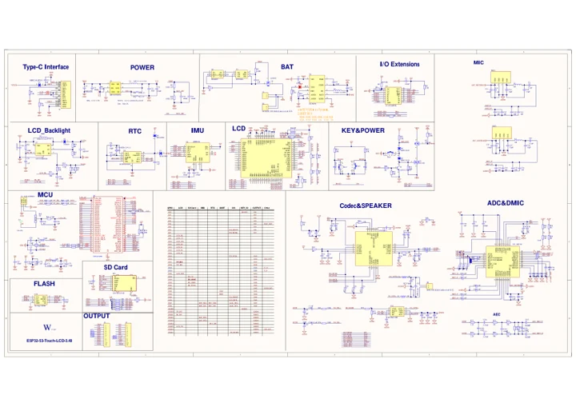

# ESP32-S3-Touch-LCD-3.49

**Waveshare** · ESP32-S3

Revision: Not identified

Coverage: Manufacturer references available; physical pinout and complete connector review are tracked separately

[Browse all manufacturers](../../../../BROWSE.md) · [Devices & IoT](../../../../DEVICES.md) · [Open in the browser guide](https://valleytech-black-wire-guide.pages.dev/?board=waveshare-esp32-esp32-s3-touch-lcd-3-49)

## Datasheets and original documentation

Board datasheet: **not yet recorded**. Visual reference: **available**.

[Manufacturer model documentation](https://docs.waveshare.com/ESP32-S3-Touch-LCD-3.49/Resources-And-Documents)

- **hardware-guide / board**: [Manufacturer pin and hardware documentation](https://www.waveshare.com/wiki/ESP32-S3-Touch-LCD-3.49) · online
- **schematic / board**: [ESP32-S3-Touch-LCD-3.49 V1 Schematic — schematic](https://files.waveshare.com/wiki/ESP32-S3-Touch-LCD-3.49/ESP32-S3-Touch-LCD-3.49-Schematic.pdf) · [saved document](../../../../library/media/2bc315a0bb3e3d3654d502c9d6ce84da18ad875511c77e73a198e8e2cd204a10.pdf)

A chip datasheet, schematic and board datasheet have different scopes. Match the exact hardware revision.

[Documentation coverage and remaining gaps](../../../../DOCUMENTATION.md)

## Onboard Resources

**board labeling image** · Source identity and visual scope inspected; PDF review covers first-page preview. Independent electrical and all-connector completeness review pending. · JPG

[Open original reference](../../../../library/media/64b1d42dc6b9f3d8f7635e7cc4f480cb7e5dbe6b67be47b1a24f41a030055bcc.jpg)

**Credit and rights:** Manufacturer artwork; reuse and print rights not established. Inclusion does not relicense the original.. Source/manufacturer: Waveshare.

[Source 1](https://www.waveshare.com/w/upload/1/1c/ESP32-S3-Touch-LCD-3.49-details-intro.jpg) · [Source 2](https://www.waveshare.com/wiki/ESP32-S3-Touch-LCD-3.49)

Manufacturer source retained unchanged. Source identity and visual scope inspected; PDF review covers first-page preview. Independent electrical and all-connector completeness review pending. See the linked manufacturer page for the numbered component legend. This is not a complete physical pinout.

Image revision: As supplied in the original; match exact board revision

SHA-256: `64b1d42dc6b9f3d8f7635e7cc4f480cb7e5dbe6b67be47b1a24f41a030055bcc`

## Interfaces

**pin function reference** · Source identity and visual scope inspected; PDF review covers first-page preview. Independent electrical and all-connector completeness review pending. · PNG

[Open original reference](../../../../library/media/d0c36ed7b0814c49f0c5285cb0868e51a01afe44b7e1a98953b286c48ccdb00e.png)

**Credit and rights:** Manufacturer artwork; reuse and print rights not established. Inclusion does not relicense the original.. Source/manufacturer: Waveshare.

[Source 1](https://www.waveshare.com/w/upload/b/b3/ESP32-S3-Touch-LCD-3.49-Hw-list.png) · [Source 2](https://www.waveshare.com/wiki/ESP32-S3-Touch-LCD-3.49)

Manufacturer source retained unchanged. Source identity and visual scope inspected; PDF review covers first-page preview. Independent electrical and all-connector completeness review pending.

Image revision: As supplied in the original; match exact board revision

SHA-256: `d0c36ed7b0814c49f0c5285cb0868e51a01afe44b7e1a98953b286c48ccdb00e`

## ESP32-S3-Touch-LCD-3.49 V1 Schematic — schematic

**reference PDF** · Source model/link and PDF signature/title checked; individual pin assignments and electrical validation pending · PDF

[Open original reference](../../../../library/media/2bc315a0bb3e3d3654d502c9d6ce84da18ad875511c77e73a198e8e2cd204a10.pdf)

**Credit and rights:** Original publisher/manufacturer artwork; redistribution and print rights not established. Attribution is not a license grant.. Source/manufacturer: Waveshare.

[Source 1](https://files.waveshare.com/wiki/ESP32-S3-Touch-LCD-3.49/ESP32-S3-Touch-LCD-3.49-Schematic.pdf) · [Source 2](https://docs.waveshare.com/ESP32-S3-Touch-LCD-3.49/Resources-And-Documents)

Original document linked from this model’s manufacturer page. Preserve the document’s exact revision and named subassembly scope; a linked accessory schematic is not a whole-device pinout. This is a circuit schematic, not a physical board pinout.

Image revision: Use the revision printed in the original document; do not assume all hardware revisions are interchangeable

SHA-256: `2bc315a0bb3e3d3654d502c9d6ce84da18ad875511c77e73a198e8e2cd204a10`

Pin assignments have not been independently electrically verified. Check board revision before wiring.
