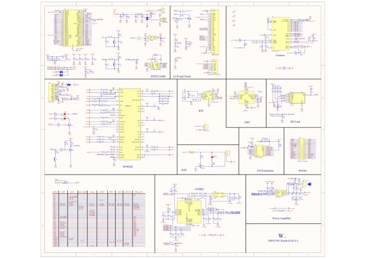
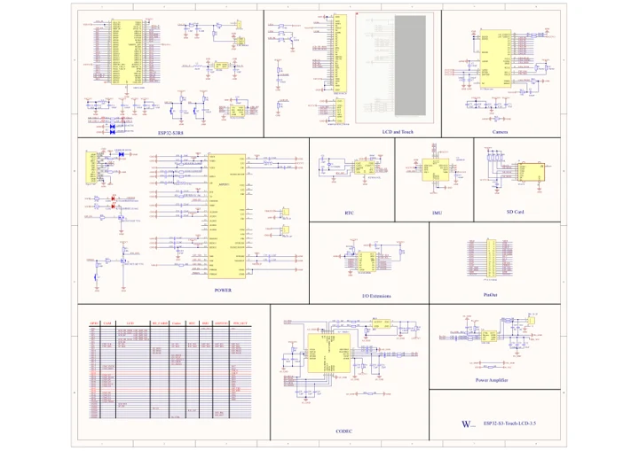

# ESP32-S3-Touch-LCD-3.5

**Waveshare** · ESP32-S3

Revision: Not identified

Coverage: Manufacturer references available; physical pinout and complete connector review are tracked separately

[Browse all manufacturers](../../../../BROWSE.md) · [Devices & IoT](../../../../DEVICES.md) · [Open in the browser guide](https://valleytech-black-wire-guide.pages.dev/?board=waveshare-esp32-esp32-s3-touch-lcd-3-5)

## Datasheets and original documentation

Board datasheet: **not yet recorded**. Visual reference: **available**.

[Manufacturer model documentation](https://docs.waveshare.com/ESP32-S3-Touch-LCD-3.5/Resources-And-Documents)

- **schematic / board**: [ESP32-S3-Touch-LCD-3.5 V2 Schematic — schematic](https://files.waveshare.com/wiki/ESP32-S3-Touch-LCD-3.5/ESP32-S3-Touch-LCD-3.5_Rev2.0.pdf) · [saved document](../../../../library/media/4704a21df091fc5a54aab009a00bdb4f70d94f7b98dc9385d7afe9d2f9b1d481.pdf)
- **schematic / board**: [ESP32-S3-Touch-LCD-3.5 V1 Schematic — schematic](https://files.waveshare.com/wiki/ESP32-S3-Touch-LCD-3.5/ESP32-S3-Touch-LCD-3.5-Schematic.pdf) · [saved document](../../../../library/media/1fc6459d66b420605c1e667ce47ff73adc80cdbed42501d58f0d773f4fd7cfcc.pdf)

A chip datasheet, schematic and board datasheet have different scopes. Match the exact hardware revision.

[Documentation coverage and remaining gaps](../../../../DOCUMENTATION.md)

## Pinout

**pinout image** · Reviewed source · JPG

[Open original reference](../../../../library/media/c01a41cf397a905d595f7d29fd0bb5ab179eae06d7e0b2a487aa8e3665319211.jpg)

**Credit and rights:** Not recorded; retain original attribution. Source/manufacturer: Waveshare.

[Source 1](https://www.waveshare.com/img/devkit/ESP32-S3-Touch-LCD-3.5/ESP32-S3-Touch-LCD-3.5-details-intro.jpg) · [Source 2](https://www.waveshare.com/esp32-s3-touch-lcd-3.5.htm)

Image revision: Not identified

SHA-256: `c01a41cf397a905d595f7d29fd0bb5ab179eae06d7e0b2a487aa8e3665319211`

## Pinout

**pinout image** · Reviewed source · PNG

[Open original reference](../../../../library/media/7860dd9ede0f17a083114551d40682ddd7c845e4f6af3f2a7346c279a420212a.png)

**Credit and rights:** Not recorded; retain original attribution. Source/manufacturer: Waveshare.

[Source 1](https://www.waveshare.com/w/upload/9/94/600px-ESP32-S3-Touch-LCD-3.5-details-intro.png) · [Source 2](https://www.waveshare.com/wiki/ESP32-S3-Touch-LCD-3.5)

Image revision: Not identified

SHA-256: `7860dd9ede0f17a083114551d40682ddd7c845e4f6af3f2a7346c279a420212a`

## Pinout

**pinout image** · Reviewed source · WEBP

[Open original reference](../../../../library/media/331ec56cf3a6fc1a0113fdbe697b7622a25e43eab8c68b5547dd563606c0052b.webp)

**Credit and rights:** Not recorded; retain original attribution. Source/manufacturer: Waveshare.

[Source 1](https://docs.waveshare.com/assets/images/ESP32-S3-Touch-LCD-3.5-details-intro-eb9b36264bce6b8cc1ba8c58154ed1ac.webp) · [Source 2](https://docs.waveshare.com/ESP32-S3-Touch-LCD-3.5)

Image revision: Not identified

SHA-256: `331ec56cf3a6fc1a0113fdbe697b7622a25e43eab8c68b5547dd563606c0052b`

## ESP32-S3-Touch-LCD-3.5 V2 Schematic — schematic

**reference PDF** · Source model/link and PDF signature/title checked; individual pin assignments and electrical validation pending · PDF

[Open original reference](../../../../library/media/4704a21df091fc5a54aab009a00bdb4f70d94f7b98dc9385d7afe9d2f9b1d481.pdf)

**Credit and rights:** Original publisher/manufacturer artwork; redistribution and print rights not established. Attribution is not a license grant.. Source/manufacturer: Waveshare.

[Source 1](https://files.waveshare.com/wiki/ESP32-S3-Touch-LCD-3.5/ESP32-S3-Touch-LCD-3.5_Rev2.0.pdf) · [Source 2](https://docs.waveshare.com/ESP32-S3-Touch-LCD-3.5/Resources-And-Documents)

Original document linked from this model’s manufacturer page. Preserve the document’s exact revision and named subassembly scope; a linked accessory schematic is not a whole-device pinout. This is a circuit schematic, not a physical board pinout.

Image revision: Use the revision printed in the original document; do not assume all hardware revisions are interchangeable

SHA-256: `4704a21df091fc5a54aab009a00bdb4f70d94f7b98dc9385d7afe9d2f9b1d481`

## ESP32-S3-Touch-LCD-3.5 V1 Schematic — schematic

**reference PDF** · Source model/link and PDF signature/title checked; individual pin assignments and electrical validation pending · PDF

[Open original reference](../../../../library/media/1fc6459d66b420605c1e667ce47ff73adc80cdbed42501d58f0d773f4fd7cfcc.pdf)

**Credit and rights:** Original publisher/manufacturer artwork; redistribution and print rights not established. Attribution is not a license grant.. Source/manufacturer: Waveshare.

[Source 1](https://files.waveshare.com/wiki/ESP32-S3-Touch-LCD-3.5/ESP32-S3-Touch-LCD-3.5-Schematic.pdf) · [Source 2](https://docs.waveshare.com/ESP32-S3-Touch-LCD-3.5/Resources-And-Documents)

Original document linked from this model’s manufacturer page. Preserve the document’s exact revision and named subassembly scope; a linked accessory schematic is not a whole-device pinout. This is a circuit schematic, not a physical board pinout.

Image revision: Use the revision printed in the original document; do not assume all hardware revisions are interchangeable

SHA-256: `1fc6459d66b420605c1e667ce47ff73adc80cdbed42501d58f0d773f4fd7cfcc`

Pin assignments have not been independently electrically verified. Check board revision before wiring.
