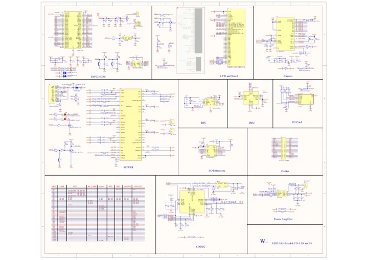
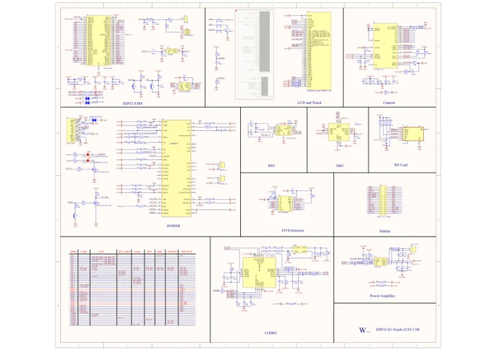

# ESP32-S3-Touch-LCD-3.5B

**Waveshare** · ESP32-S3

Revision: Not identified

Coverage: Manufacturer references available; physical pinout and complete connector review are tracked separately

[Browse all manufacturers](../../../../BROWSE.md) · [Devices & IoT](../../../../DEVICES.md) · [Open in the browser guide](https://valleytech-black-wire-guide.pages.dev/?board=waveshare-esp32-esp32-s3-touch-lcd-3-5b)

## Datasheets and original documentation

Board datasheet: **not yet recorded**. Visual reference: **available**.

[Manufacturer model documentation](https://docs.waveshare.com/ESP32-S3-Touch-LCD-3.5B/Resources-And-Documents)

- **schematic / board**: [ESP32-S3-Touch-LCD-3.5B V2 Schematic — schematic](https://files.waveshare.com/wiki/ESP32-S3-Touch-LCD-3.5B/ESP32-S3-Touch-LCD-3.5B_V2.0.pdf) · [saved document](../../../../library/media/a0b65d8be900a4017d056d5b9ef8626bd138cb8be8d5814f40fb7ad34d4f321b.pdf)
- **schematic / board**: [ESP32-S3-Touch-LCD-3.5B V1 Schematic — schematic](https://files.waveshare.com/wiki/ESP32-S3-Touch-LCD-3.5B/ESP32-S3-Touch-LCD-3.5B-Schematic.pdf) · [saved document](../../../../library/media/71fe3528189c62423ea05af6cfa57ed07921cdd259cc932b862bc028870939f3.pdf)

A chip datasheet, schematic and board datasheet have different scopes. Match the exact hardware revision.

[Documentation coverage and remaining gaps](../../../../DOCUMENTATION.md)

## Pinout

**pinout image** · Reviewed source · JPG

[Open original reference](../../../../library/media/a0102babe339dab503a050c41f399d607544b928b5abd8e4df62b1518001b3b7.jpg)

**Credit and rights:** Not recorded; retain original attribution. Source/manufacturer: Waveshare.

[Source 1](https://www.waveshare.com/img/devkit/ESP32-S3-Touch-LCD-3.5B/ESP32-S3-Touch-LCD-3.5B-details-intro.jpg) · [Source 2](https://www.waveshare.com/esp32-s3-touch-lcd-3.5b.htm)

Image revision: Not identified

SHA-256: `a0102babe339dab503a050c41f399d607544b928b5abd8e4df62b1518001b3b7`

## Pinout

**pinout image** · Reviewed source · WEBP

[Open original reference](../../../../library/media/df955418e01aedd7910dd3aeebb82637076ac7cfba65b9d8fe18040cc9c6e748.webp)

**Credit and rights:** Not recorded; retain original attribution. Source/manufacturer: Waveshare.

[Source 1](https://docs.waveshare.com/assets/images/ESP32-S3-Touch-LCD-3.5B-details-intro-3f1de38fd6cce29fc059d18bc651a416.webp) · [Source 2](https://docs.waveshare.com/ESP32-S3-Touch-LCD-3.5B)

Image revision: Not identified

SHA-256: `df955418e01aedd7910dd3aeebb82637076ac7cfba65b9d8fe18040cc9c6e748`

## Pinout

**pinout image** · Reviewed source · JPG

[Open original reference](../../../../library/media/6038de2547e930da4b757291afd194bfe509ab9a2eb956a44cfbeabdf55bfb1f.jpg)

**Credit and rights:** Not recorded; retain original attribution. Source/manufacturer: Waveshare.

[Source 1](https://www.waveshare.com/w/upload/6/63/600px-ESP32-S3-Touch-LCD-3.5B-details-intro.jpg) · [Source 2](https://www.waveshare.com/wiki/ESP32-S3-Touch-LCD-3.5B)

Image revision: Not identified

SHA-256: `6038de2547e930da4b757291afd194bfe509ab9a2eb956a44cfbeabdf55bfb1f`

## ESP32-S3-Touch-LCD-3.5B V2 Schematic — schematic

**reference PDF** · Source model/link and PDF signature/title checked; individual pin assignments and electrical validation pending · PDF

[Open original reference](../../../../library/media/a0b65d8be900a4017d056d5b9ef8626bd138cb8be8d5814f40fb7ad34d4f321b.pdf)

**Credit and rights:** Original publisher/manufacturer artwork; redistribution and print rights not established. Attribution is not a license grant.. Source/manufacturer: Waveshare.

[Source 1](https://files.waveshare.com/wiki/ESP32-S3-Touch-LCD-3.5B/ESP32-S3-Touch-LCD-3.5B_V2.0.pdf) · [Source 2](https://docs.waveshare.com/ESP32-S3-Touch-LCD-3.5B/Resources-And-Documents)

Original document linked from this model’s manufacturer page. Preserve the document’s exact revision and named subassembly scope; a linked accessory schematic is not a whole-device pinout. This is a circuit schematic, not a physical board pinout.

Image revision: Use the revision printed in the original document; do not assume all hardware revisions are interchangeable

SHA-256: `a0b65d8be900a4017d056d5b9ef8626bd138cb8be8d5814f40fb7ad34d4f321b`

## ESP32-S3-Touch-LCD-3.5B V1 Schematic — schematic

**reference PDF** · Source model/link and PDF signature/title checked; individual pin assignments and electrical validation pending · PDF

[Open original reference](../../../../library/media/71fe3528189c62423ea05af6cfa57ed07921cdd259cc932b862bc028870939f3.pdf)

**Credit and rights:** Original publisher/manufacturer artwork; redistribution and print rights not established. Attribution is not a license grant.. Source/manufacturer: Waveshare.

[Source 1](https://files.waveshare.com/wiki/ESP32-S3-Touch-LCD-3.5B/ESP32-S3-Touch-LCD-3.5B-Schematic.pdf) · [Source 2](https://docs.waveshare.com/ESP32-S3-Touch-LCD-3.5B/Resources-And-Documents)

Original document linked from this model’s manufacturer page. Preserve the document’s exact revision and named subassembly scope; a linked accessory schematic is not a whole-device pinout. This is a circuit schematic, not a physical board pinout.

Image revision: Use the revision printed in the original document; do not assume all hardware revisions are interchangeable

SHA-256: `71fe3528189c62423ea05af6cfa57ed07921cdd259cc932b862bc028870939f3`

Pin assignments have not been independently electrically verified. Check board revision before wiring.
