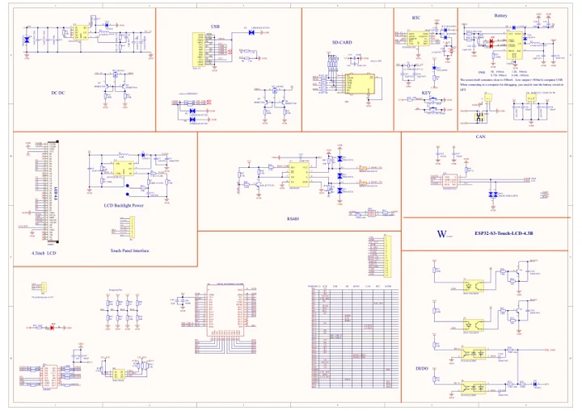

# ESP32-S3-Touch-LCD-4.3B

**Waveshare** · ESP32-S3

Revision: Not identified

Coverage: Manufacturer references available; physical pinout and complete connector review are tracked separately

[Browse all manufacturers](../../../../BROWSE.md) · [Devices & IoT](../../../../DEVICES.md) · [Open in the browser guide](https://valleytech-black-wire-guide.pages.dev/?board=waveshare-esp32-esp32-s3-touch-lcd-4-3b)

## Datasheets and original documentation

Board datasheet: **not yet recorded**. Visual reference: **available**.

[Manufacturer model documentation](https://docs.waveshare.com/ESP32-S3-Touch-LCD-4.3B)

- **schematic / board**: [ESP32-S3-Touch-LCD-4.3B Schematic — schematic](https://files.waveshare.com/wiki/ESP32-S3-Touch-LCD-4.3B/ESP32-S3-Touch-LCD-4.3B-Sch.pdf) · [saved document](../../../../library/media/8dea13e5bc5b72fa77b7515bcb153a6ec5be5079f0079f28535eb30d808ad9c9.pdf)

A chip datasheet, schematic and board datasheet have different scopes. Match the exact hardware revision.

[Documentation coverage and remaining gaps](../../../../DOCUMENTATION.md)

## Pinout

**pinout image** · Reviewed source · JPG

[Open original reference](../../../../library/media/69caee206478ff98c88ad5435e54bf3a27a50df60ba84d8d791d10d607043030.jpg)

**Credit and rights:** Not recorded; retain original attribution. Source/manufacturer: Waveshare.

[Source 1](https://www.waveshare.com/img/devkit/ESP32-S3-Touch-LCD-4.3B/ESP32-S3-Touch-LCD-4.3B-details-9.jpg) · [Source 2](https://www.waveshare.com/esp32-s3-touch-lcd-4.3b.htm)

Image revision: Not identified

SHA-256: `69caee206478ff98c88ad5435e54bf3a27a50df60ba84d8d791d10d607043030`

## Pinout

**pinout image** · Reviewed source · WEBP

[Open original reference](../../../../library/media/6b6d207e8ddd4c384ee1eb180559c5ac3202eeee1db81436eae71188b151c402.webp)

**Credit and rights:** Not recorded; retain original attribution. Source/manufacturer: Waveshare.

[Source 1](https://docs.waveshare.com/assets/images/ESP32-S3-Touch-4.3B-details-0edde12d537b5974670d2bb83e8ff254.webp) · [Source 2](https://docs.waveshare.com/ESP32-S3-Touch-LCD-4.3B)

Image revision: Not identified

SHA-256: `6b6d207e8ddd4c384ee1eb180559c5ac3202eeee1db81436eae71188b151c402`

## ESP32-S3-Touch-LCD-4.3B Schematic — schematic

**reference PDF** · Source model/link and PDF signature/title checked; individual pin assignments and electrical validation pending · PDF

[Open original reference](../../../../library/media/8dea13e5bc5b72fa77b7515bcb153a6ec5be5079f0079f28535eb30d808ad9c9.pdf)

**Credit and rights:** Original publisher/manufacturer artwork; redistribution and print rights not established. Attribution is not a license grant.. Source/manufacturer: Waveshare.

[Source 1](https://files.waveshare.com/wiki/ESP32-S3-Touch-LCD-4.3B/ESP32-S3-Touch-LCD-4.3B-Sch.pdf) · [Source 2](https://docs.waveshare.com/ESP32-S3-Touch-LCD-4.3B)

Original document linked from this model’s manufacturer page. Preserve the document’s exact revision and named subassembly scope; a linked accessory schematic is not a whole-device pinout. This is a circuit schematic, not a physical board pinout.

Image revision: Use the revision printed in the original document; do not assume all hardware revisions are interchangeable

SHA-256: `8dea13e5bc5b72fa77b7515bcb153a6ec5be5079f0079f28535eb30d808ad9c9`

Pin assignments have not been independently electrically verified. Check board revision before wiring.
