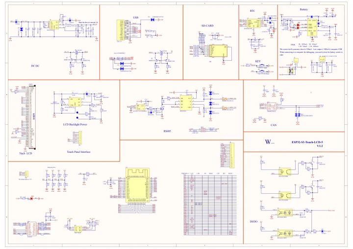

# ESP32-S3-Touch-LCD-5

**Waveshare** · ESP32-S3

Revision: Not identified

Coverage: Manufacturer references available; physical pinout and complete connector review are tracked separately

[Browse all manufacturers](../../../../BROWSE.md) · [Devices & IoT](../../../../DEVICES.md) · [Open in the browser guide](https://valleytech-black-wire-guide.pages.dev/?board=waveshare-esp32-esp32-s3-touch-lcd-5)

## Datasheets and original documentation

Board datasheet: **not yet recorded**. Visual reference: **available**.

[Manufacturer model documentation](https://docs.waveshare.com/ESP32-S3-Touch-LCD-5)

- **schematic / board**: [ESP32-S3-Touch-LCD-5 Schematic — schematic](https://files.waveshare.com/wiki/ESP32-S3-Touch-LCD-5/ESP32-S3-Touch-LCD-5-Sch.pdf) · [saved document](../../../../library/media/d5b0dd67ddf93fc2ac045043db9f65cbba12652f8ee20bd1fd719fe300ae8cb6.pdf)

A chip datasheet, schematic and board datasheet have different scopes. Match the exact hardware revision.

[Documentation coverage and remaining gaps](../../../../DOCUMENTATION.md)

## Pinout

**pinout image** · Reviewed source · JPG

[Open original reference](../../../../library/media/9b27e071c9740598d9439c96bc04c611c39615577d086b6d232af0dcd1c80a0d.jpg)

**Credit and rights:** Not recorded; retain original attribution. Source/manufacturer: Waveshare.

[Source 1](https://www.waveshare.com/img/devkit/ESP32-S3-Touch-LCD-5/ESP32-S3-Touch-LCD-5-details-9.jpg) · [Source 2](https://www.waveshare.com/esp32-s3-touch-lcd-5.htm)

Image revision: Not identified

SHA-256: `9b27e071c9740598d9439c96bc04c611c39615577d086b6d232af0dcd1c80a0d`

## Pinout

**pinout image** · Reviewed source · PNG

[Open original reference](../../../../library/media/fdb3fd0f39e65927a8712ca2804e43564549d5fd045fb4d838bee6e190cd33b5.png)

**Credit and rights:** Not recorded; retain original attribution. Source/manufacturer: Waveshare.

[Source 1](https://www.waveshare.com/w/upload/2/21/700px-ESP32-S3-Touch-LCD-5-details-9.png) · [Source 2](https://www.waveshare.com/wiki/ESP32-S3-Touch-LCD-5)

Image revision: Not identified

SHA-256: `fdb3fd0f39e65927a8712ca2804e43564549d5fd045fb4d838bee6e190cd33b5`

## Pinout

**pinout image** · Reviewed source · WEBP

[Open original reference](../../../../library/media/e9eb7eec5b18911df8f09dcb24eb77df2b84172a386acb1ae4ca71fa1840c211.webp)

**Credit and rights:** Not recorded; retain original attribution. Source/manufacturer: Waveshare.

[Source 1](https://docs.waveshare.com/assets/images/ESP32-S3-Touch-LCD-5-details-9-f93db57f041919589aefd349f77a2605.webp) · [Source 2](https://docs.waveshare.com/ESP32-S3-Touch-LCD-5)

Image revision: Not identified

SHA-256: `e9eb7eec5b18911df8f09dcb24eb77df2b84172a386acb1ae4ca71fa1840c211`

## ESP32-S3-Touch-LCD-5 Schematic — schematic

**reference PDF** · Source model/link and PDF signature/title checked; individual pin assignments and electrical validation pending · PDF

[Open original reference](../../../../library/media/d5b0dd67ddf93fc2ac045043db9f65cbba12652f8ee20bd1fd719fe300ae8cb6.pdf)

**Credit and rights:** Original publisher/manufacturer artwork; redistribution and print rights not established. Attribution is not a license grant.. Source/manufacturer: Waveshare.

[Source 1](https://files.waveshare.com/wiki/ESP32-S3-Touch-LCD-5/ESP32-S3-Touch-LCD-5-Sch.pdf) · [Source 2](https://docs.waveshare.com/ESP32-S3-Touch-LCD-5)

Original document linked from this model’s manufacturer page. Preserve the document’s exact revision and named subassembly scope; a linked accessory schematic is not a whole-device pinout. This is a circuit schematic, not a physical board pinout.

Image revision: Use the revision printed in the original document; do not assume all hardware revisions are interchangeable

SHA-256: `d5b0dd67ddf93fc2ac045043db9f65cbba12652f8ee20bd1fd719fe300ae8cb6`

Pin assignments have not been independently electrically verified. Check board revision before wiring.
