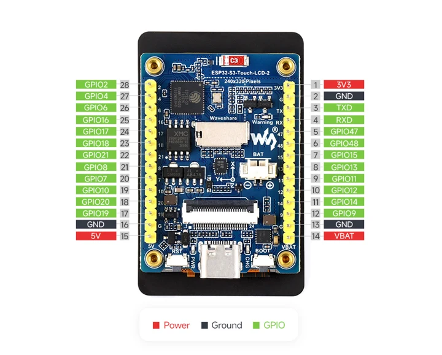

# ESP32S3-TOUCH-LCD-2

**Waveshare** · ESP32-S3

Revision: Not identified

Coverage: Manufacturer references available; physical pinout and complete connector review are tracked separately

[Browse all manufacturers](../../../../BROWSE.md) · [Devices & IoT](../../../../DEVICES.md) · [Open in the browser guide](https://valleytech-black-wire-guide.pages.dev/?board=waveshare-esp32-esp32s3-touch-lcd-2)

## Datasheets and original documentation

Board datasheet: **not yet recorded**. Visual reference: **available**.

[Manufacturer model documentation](https://www.waveshare.com/esp32-s3-touch-lcd-2.htm)

A chip datasheet, schematic and board datasheet have different scopes. Match the exact hardware revision.

[Documentation coverage and remaining gaps](../../../../DOCUMENTATION.md)

## ESP32-S3-Touch-LCD-2 external connector pinout

**pinout image** · Visually reviewed for identity and reference scope; independent electrical review pending · JPG

[Open original reference](../../../../library/media/650d3197f4999c852e428e25e25026f24fb2b076b081c63108c529a345e6e296.jpg)

**Credit and rights:** Original publisher/manufacturer artwork; redistribution and print rights not established. Attribution is not a license grant.. Source/manufacturer: Waveshare.

[Source 1](https://www.waveshare.com/img/devkit/ESP32-S3-Touch-LCD-2/ESP32-S3-Touch-LCD-2-details-inter.jpg) · [Source 2](https://www.waveshare.com/esp32-s3-touch-lcd-2.htm)

Partial physical map: the pictured external 28-pin connector, not every internal peripheral.

Image revision: Use the revision printed in the original document; do not assume all hardware revisions are interchangeable

SHA-256: `650d3197f4999c852e428e25e25026f24fb2b076b081c63108c529a345e6e296`

Pin assignments have not been independently electrically verified. Check board revision before wiring.
