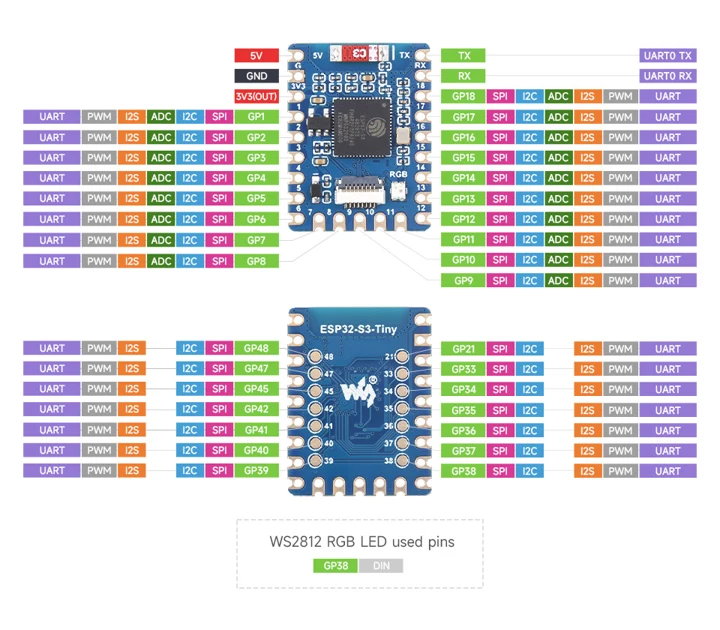

# Waveshare ESP32-S3-Tiny-N8R8

**Waveshare** · ESP32-S3

Revision: Not identified

Coverage: Manufacturer references available; physical pinout and complete connector review are tracked separately

[Browse all manufacturers](../../../../BROWSE.md) · [Devices & IoT](../../../../DEVICES.md) · [Open in the browser guide](https://valleytech-black-wire-guide.pages.dev/?board=waveshare-esp32-esp32-s3-tiny-n8r8)

## Datasheets and original documentation

Board datasheet: **not yet recorded**. Visual reference: **available**.

[Manufacturer model documentation](https://www.waveshare.com/esp32-s3-tiny.htm?sku=33914)

A chip datasheet, schematic and board datasheet have different scopes. Match the exact hardware revision.

[Documentation coverage and remaining gaps](../../../../DOCUMENTATION.md)

## ESP32-S3-Tiny N8R8 front and back pinout

**pinout image** · Visually reviewed for identity and reference scope; independent electrical review pending · JPG

[Open original reference](../../../../library/media/ca73c19d54de06bcbcf9a03c65a182e99ea4db90e6e13f8a5967614b0f31dd81.jpg)

**Credit and rights:** Original publisher/manufacturer artwork; redistribution and print rights not established. Attribution is not a license grant.. Source/manufacturer: Waveshare.

[Source 1](https://www.waveshare.com/img/devkit/ESP32-S3-Tiny/ESP32-S3-Tiny-details-inter.jpg) · [Source 2](https://www.waveshare.com/esp32-s3-tiny.htm?sku=33914)

Match N8R8 assembly and depicted PCB revision.

Image revision: Use the revision printed in the original document; do not assume all hardware revisions are interchangeable

SHA-256: `ca73c19d54de06bcbcf9a03c65a182e99ea4db90e6e13f8a5967614b0f31dd81`

Pin assignments have not been independently electrically verified. Check board revision before wiring.
