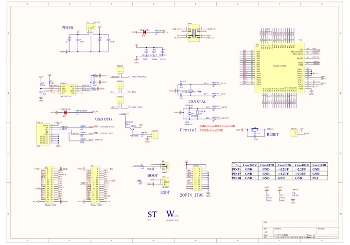

# Core103R

**Waveshare** · Other

Revision: Not identified

Coverage: Manufacturer references available; physical pinout and complete connector review are tracked separately

[Browse all manufacturers](../../../../BROWSE.md) · [Devices & IoT](../../../../DEVICES.md) · [Open in the browser guide](https://valleytech-black-wire-guide.pages.dev/?board=waveshare-other-core103r)

## Datasheets and original documentation

Board datasheet: **not yet recorded**. Visual reference: **available**.

[Manufacturer model documentation](https://www.waveshare.com/wiki/Core103R)

- **schematic / board**: [Schematic — schematic](https://files.waveshare.com/upload/0/05/CorexxxR-Schematic.pdf) · [saved document](../../../../library/media/3033e3a538c5add0041abd8ef48f7ed94e9949ef4949c4afcb74f4af3d1c7165.pdf)

A chip datasheet, schematic and board datasheet have different scopes. Match the exact hardware revision.

[Documentation coverage and remaining gaps](../../../../DOCUMENTATION.md)

## Schematic — schematic

**reference PDF** · Source model/link and PDF signature/title checked; individual pin assignments and electrical validation pending · PDF

[Open original reference](../../../../library/media/3033e3a538c5add0041abd8ef48f7ed94e9949ef4949c4afcb74f4af3d1c7165.pdf)

**Credit and rights:** Original publisher/manufacturer artwork; redistribution and print rights not established. Attribution is not a license grant.. Source/manufacturer: Waveshare.

[Source 1](https://files.waveshare.com/upload/0/05/CorexxxR-Schematic.pdf) · [Source 2](https://www.waveshare.com/wiki/Core103R)

Original document linked from this model’s manufacturer page. Preserve the document’s exact revision and named subassembly scope; a linked accessory schematic is not a whole-device pinout. This is a circuit schematic, not a physical board pinout.

Image revision: Use the revision printed in the original document; do not assume all hardware revisions are interchangeable

SHA-256: `3033e3a538c5add0041abd8ef48f7ed94e9949ef4949c4afcb74f4af3d1c7165`

Pin assignments have not been independently electrically verified. Check board revision before wiring.
