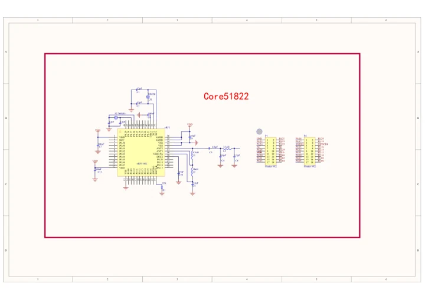

# Core51822 (B)

**Waveshare** · Other

Revision: Not identified

Coverage: Manufacturer references available; physical pinout and complete connector review are tracked separately

[Browse all manufacturers](../../../../BROWSE.md) · [Devices & IoT](../../../../DEVICES.md) · [Open in the browser guide](https://valleytech-black-wire-guide.pages.dev/?board=waveshare-other-core51822-b)

## Datasheets and original documentation

Board datasheet: **not yet recorded**. Visual reference: **available**.

[Manufacturer model documentation](https://www.waveshare.com/wiki/Core51822_(B))

- **schematic / board**: [Schematic — schematic](https://files.waveshare.com/upload/5/57/Core51822-Schematic.pdf) · [saved document](../../../../library/media/f95e6635ded76fccd66521462415cb049a07a12f966f98998a798a757ae6fa8e.pdf)

A chip datasheet, schematic and board datasheet have different scopes. Match the exact hardware revision.

[Documentation coverage and remaining gaps](../../../../DOCUMENTATION.md)

## Pinout

**pinout image** · Reviewed source · JPG

[Open original reference](../../../../library/media/5701b9b088470d1601165ea62b467242c7593b7bf0c1849f5367e1f4678a0e54.jpg)

**Credit and rights:** Not recorded; retain original attribution. Source/manufacturer: Waveshare.

[Source 1](https://www.waveshare.com/img/devkit/accBoard/Core51822-B/Core51822-B-pin.jpg) · [Source 2](https://www.waveshare.com/core51822-b.htm)

Image revision: Not identified

SHA-256: `5701b9b088470d1601165ea62b467242c7593b7bf0c1849f5367e1f4678a0e54`

## Schematic — schematic

**reference PDF** · Source model/link and PDF signature/title checked; individual pin assignments and electrical validation pending · PDF

[Open original reference](../../../../library/media/f95e6635ded76fccd66521462415cb049a07a12f966f98998a798a757ae6fa8e.pdf)

**Credit and rights:** Original publisher/manufacturer artwork; redistribution and print rights not established. Attribution is not a license grant.. Source/manufacturer: Waveshare.

[Source 1](https://files.waveshare.com/upload/5/57/Core51822-Schematic.pdf) · [Source 2](https://www.waveshare.com/wiki/Core51822_(B))

Original document linked from this model’s manufacturer page. Preserve the document’s exact revision and named subassembly scope; a linked accessory schematic is not a whole-device pinout. This is a circuit schematic, not a physical board pinout.

Image revision: Use the revision printed in the original document; do not assume all hardware revisions are interchangeable

SHA-256: `f95e6635ded76fccd66521462415cb049a07a12f966f98998a798a757ae6fa8e`

Pin assignments have not been independently electrically verified. Check board revision before wiring.
