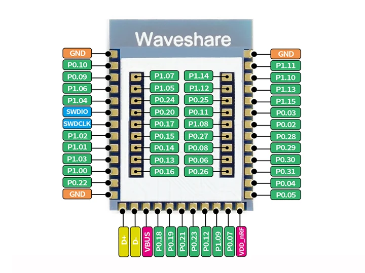
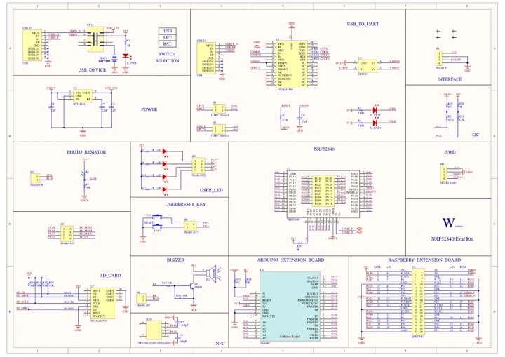

# NRF52840 Eval Kit

**Waveshare** · Other

Revision: Not identified

Coverage: Manufacturer references available; physical pinout and complete connector review are tracked separately

[Browse all manufacturers](../../../../BROWSE.md) · [Devices & IoT](../../../../DEVICES.md) · [Open in the browser guide](https://valleytech-black-wire-guide.pages.dev/?board=waveshare-other-nrf52840-eval-kit)

## Datasheets and original documentation

Board datasheet: **not yet recorded**. Visual reference: **available**.

[Manufacturer model documentation](https://www.waveshare.com/wiki/NRF52840_Eval_Kit)

- **schematic / board**: [Schematic — schematic](https://files.waveshare.com/upload/f/f2/NRF52840-Eval-Kit-Schematic.pdf) · [saved document](../../../../library/media/6aedd377365af170c014e8b4ed03811784b25d36b4be9a3dec7e8f49a43b1a1f.pdf)

A chip datasheet, schematic and board datasheet have different scopes. Match the exact hardware revision.

[Documentation coverage and remaining gaps](../../../../DOCUMENTATION.md)

## Core52840 module pad map within nRF52840 EvalKit

**pinout image** · Visually reviewed for identity and reference scope; independent electrical review pending · JPG

[Open original reference](../../../../library/media/711776af767798b073c8c4aaaa861f9d1224140da3817284a3adcaee10261b68.jpg)

**Credit and rights:** Original publisher/manufacturer artwork; redistribution and print rights not established. Attribution is not a license grant.. Source/manufacturer: Waveshare.

[Source 1](https://www.waveshare.com/img/devkit/accBoard/Core52840/Core52840-pins.jpg) · [Source 2](https://www.waveshare.com/core52840.htm)

Partial kit coverage: Core52840 module pads only, not a complete EvalKit carrier pinout.

Image revision: Use the revision printed in the original document; do not assume all hardware revisions are interchangeable

SHA-256: `711776af767798b073c8c4aaaa861f9d1224140da3817284a3adcaee10261b68`

## Schematic — schematic

**reference PDF** · Source model/link and PDF signature/title checked; individual pin assignments and electrical validation pending · PDF

[Open original reference](../../../../library/media/6aedd377365af170c014e8b4ed03811784b25d36b4be9a3dec7e8f49a43b1a1f.pdf)

**Credit and rights:** Original publisher/manufacturer artwork; redistribution and print rights not established. Attribution is not a license grant.. Source/manufacturer: Waveshare.

[Source 1](https://files.waveshare.com/upload/f/f2/NRF52840-Eval-Kit-Schematic.pdf) · [Source 2](https://www.waveshare.com/wiki/NRF52840_Eval_Kit)

Original document linked from this model’s manufacturer page. Preserve the document’s exact revision and named subassembly scope; a linked accessory schematic is not a whole-device pinout. This is a circuit schematic, not a physical board pinout.

Image revision: Use the revision printed in the original document; do not assume all hardware revisions are interchangeable

SHA-256: `6aedd377365af170c014e8b4ed03811784b25d36b4be9a3dec7e8f49a43b1a1f`

Pin assignments have not been independently electrically verified. Check board revision before wiring.
