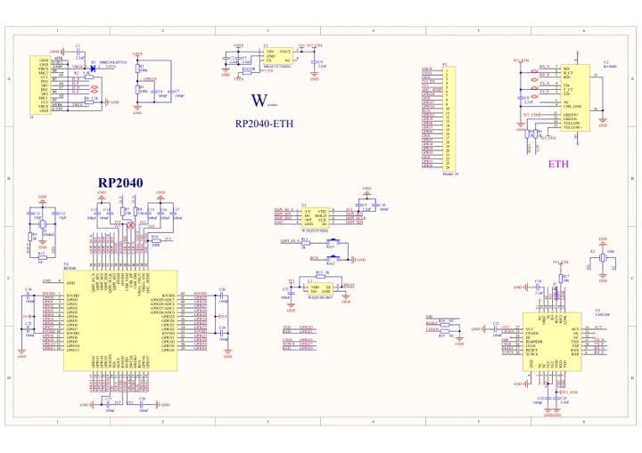
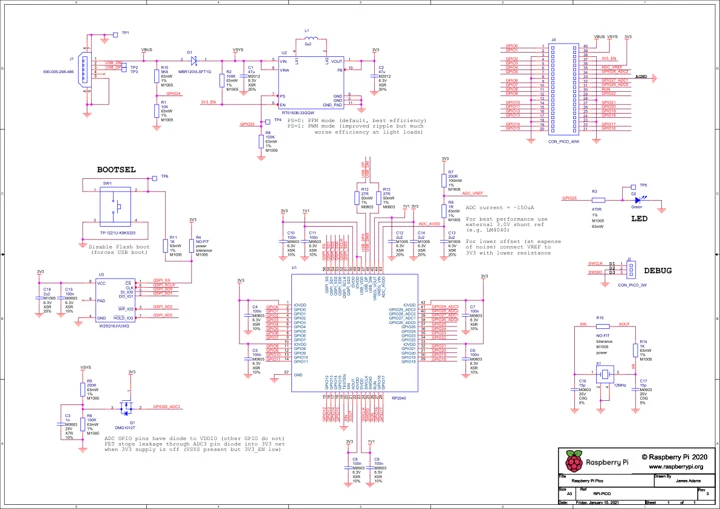

# RP2040-ETH

**Waveshare** · RP2040

Revision: Not identified

Coverage: Manufacturer references available; physical pinout and complete connector review are tracked separately

[Browse all manufacturers](../../../../BROWSE.md) · [Devices & IoT](../../../../DEVICES.md) · [Open in the browser guide](https://valleytech-black-wire-guide.pages.dev/?board=waveshare-rp2040-rp2040-eth)

## Datasheets and original documentation

Board datasheet: **not yet recorded**. Visual reference: **available**.

[Manufacturer model documentation](https://www.waveshare.com/wiki/RP2040-ETH)

- **schematic / board**: [Schematic — schematic](https://files.waveshare.com/upload/2/20/RP2040-ETH-SchDoc.pdf) · [saved document](../../../../library/media/bfb6e78ede14ba1e3f93a37ac56042dca986841e26ccec457cb4c4b055d3fe6d.pdf)
- **schematic / board**: [Raspberry Pi Pico Schematic — schematic](https://files.waveshare.com/upload/e/ed/RPI-PICO-R3-PUBLIC-SCHEMATIC.pdf) · [saved document](../../../../library/media/e953cefe8fea17870a45cd1937706e19b9689b2d75a1d3432783cf017b002300.pdf)

A chip datasheet, schematic and board datasheet have different scopes. Match the exact hardware revision.

[Documentation coverage and remaining gaps](../../../../DOCUMENTATION.md)

## Pinout

**pinout image** · Reviewed source · JPG

[Open original reference](../../../../library/media/7bbbcb9123fdaeaae7b2de594daf7508891b4d32d3fbe4835b3c0d1e2d4074d7.jpg)

**Credit and rights:** Not recorded; retain original attribution. Source/manufacturer: Waveshare.

[Source 1](https://www.waveshare.com/w/upload/1/1a/RP2040-ETH02.jpg) · [Source 2](https://www.waveshare.com/wiki/RP2040-ETH) · [Source 3](https://www.waveshare.com/rp2040-eth.htm)

Image revision: Not identified

SHA-256: `7bbbcb9123fdaeaae7b2de594daf7508891b4d32d3fbe4835b3c0d1e2d4074d7`

## Schematic — schematic

**reference PDF** · Source model/link and PDF signature/title checked; individual pin assignments and electrical validation pending · PDF

[Open original reference](../../../../library/media/bfb6e78ede14ba1e3f93a37ac56042dca986841e26ccec457cb4c4b055d3fe6d.pdf)

**Credit and rights:** Original publisher/manufacturer artwork; redistribution and print rights not established. Attribution is not a license grant.. Source/manufacturer: Waveshare.

[Source 1](https://files.waveshare.com/upload/2/20/RP2040-ETH-SchDoc.pdf) · [Source 2](https://www.waveshare.com/wiki/RP2040-ETH)

Original document linked from this model’s manufacturer page. Preserve the document’s exact revision and named subassembly scope; a linked accessory schematic is not a whole-device pinout. This is a circuit schematic, not a physical board pinout.

Image revision: Use the revision printed in the original document; do not assume all hardware revisions are interchangeable

SHA-256: `bfb6e78ede14ba1e3f93a37ac56042dca986841e26ccec457cb4c4b055d3fe6d`

## Raspberry Pi Pico Schematic — schematic

**reference PDF** · Source model/link and PDF signature/title checked; individual pin assignments and electrical validation pending · PDF

[Open original reference](../../../../library/media/e953cefe8fea17870a45cd1937706e19b9689b2d75a1d3432783cf017b002300.pdf)

**Credit and rights:** Original publisher/manufacturer artwork; redistribution and print rights not established. Attribution is not a license grant.. Source/manufacturer: Waveshare.

[Source 1](https://files.waveshare.com/upload/e/ed/RPI-PICO-R3-PUBLIC-SCHEMATIC.pdf) · [Source 2](https://www.waveshare.com/wiki/RP2040-ETH)

Original document linked from this model’s manufacturer page. Preserve the document’s exact revision and named subassembly scope; a linked accessory schematic is not a whole-device pinout. This is a circuit schematic, not a physical board pinout.

Image revision: Use the revision printed in the original document; do not assume all hardware revisions are interchangeable

SHA-256: `e953cefe8fea17870a45cd1937706e19b9689b2d75a1d3432783cf017b002300`

Pin assignments have not been independently electrically verified. Check board revision before wiring.
