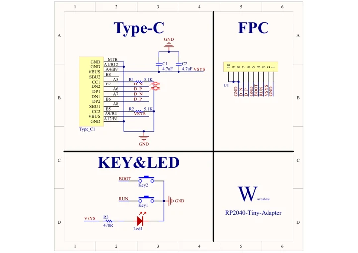
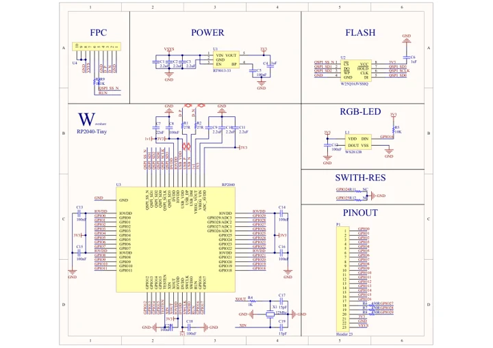
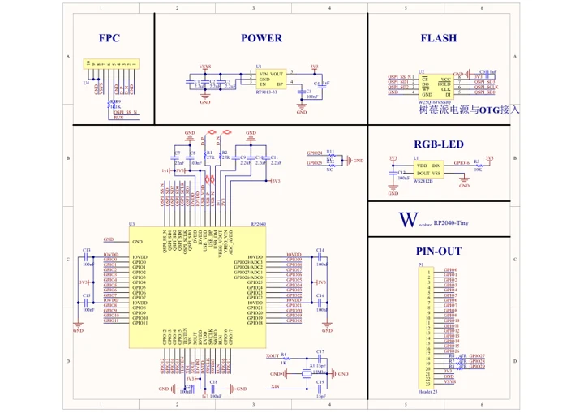

# RP2040-Tiny

**Waveshare** · RP2040

Revision: Not identified

Coverage: Manufacturer references available; physical pinout and complete connector review are tracked separately

[Browse all manufacturers](../../../../BROWSE.md) · [Devices & IoT](../../../../DEVICES.md) · [Open in the browser guide](https://valleytech-black-wire-guide.pages.dev/?board=waveshare-rp2040-rp2040-tiny)

## Datasheets and original documentation

Board datasheet: **not yet recorded**. Visual reference: **available**.

[Manufacturer model documentation](https://www.waveshare.com/wiki/RP2040-Tiny)

- **schematic / board**: [RP2040-Tiny Adapter V1.1 Schematic — schematic](https://files.waveshare.com/upload/3/35/RP2040-Tiny-Adapter_V1.1-SCH.pdf) · [saved document](../../../../library/media/72f6872c757fa3d6f4d1e6fe1683b966ab1078bea3521eeb7dd242d9b8f02536.pdf)
- **schematic / board**: [RP2040-Tiny Schematic — schematic](https://files.waveshare.com/upload/7/7a/RP2040-Tiny_Schematic.pdf) · [saved document](../../../../library/media/00c562cfefcb797b061a5c2323573c5ba838671a01aaac410637600196f75abc.pdf)
- **schematic / board**: [V1.1 Schematic — schematic](https://files.waveshare.com/upload/7/7f/RP2040-Tiny_V1.1_SCH.pdf) · [saved document](../../../../library/media/09636cbcb719a6bad7f72997882d8558494cac4a6cce000b648478cd6aeb15b2.pdf)

A chip datasheet, schematic and board datasheet have different scopes. Match the exact hardware revision.

[Documentation coverage and remaining gaps](../../../../DOCUMENTATION.md)

## Pinout

**pinout image** · Reviewed source · JPG

[Open original reference](../../../../library/media/6ab5f80defb363c23bf60ed533e26e5eeb1037d3697897e56f65a77da2df5f91.jpg)

**Credit and rights:** Not recorded; retain original attribution. Source/manufacturer: Waveshare.

[Source 1](https://www.waveshare.com/img/devkit/RP2040-Tiny-Kit/RP2040-Tiny-Kit-details-11.jpg) · [Source 2](https://www.waveshare.com/rp2040-tiny.htm)

Image revision: Not identified

SHA-256: `6ab5f80defb363c23bf60ed533e26e5eeb1037d3697897e56f65a77da2df5f91`

## Pinout

**pinout image** · Reviewed source · PNG

[Open original reference](../../../../library/media/520d5b7f3dd15cccad36d070814c4345d1f711e156c6f604393e7b9c5ec657ee.png)

**Credit and rights:** Not recorded; retain original attribution. Source/manufacturer: Waveshare.

[Source 1](https://www.waveshare.com/w/upload/f/f2/RP2040-Tiny-Kit-details-11.png) · [Source 2](https://www.waveshare.com/wiki/RP2040-Tiny)

Image revision: Not identified

SHA-256: `520d5b7f3dd15cccad36d070814c4345d1f711e156c6f604393e7b9c5ec657ee`

## RP2040-Tiny Adapter V1.1 Schematic — schematic

**reference PDF** · Source model/link and PDF signature/title checked; individual pin assignments and electrical validation pending · PDF

[Open original reference](../../../../library/media/72f6872c757fa3d6f4d1e6fe1683b966ab1078bea3521eeb7dd242d9b8f02536.pdf)

**Credit and rights:** Original publisher/manufacturer artwork; redistribution and print rights not established. Attribution is not a license grant.. Source/manufacturer: Waveshare.

[Source 1](https://files.waveshare.com/upload/3/35/RP2040-Tiny-Adapter_V1.1-SCH.pdf) · [Source 2](https://www.waveshare.com/wiki/RP2040-Tiny)

Original document linked from this model’s manufacturer page. Preserve the document’s exact revision and named subassembly scope; a linked accessory schematic is not a whole-device pinout. This is a circuit schematic, not a physical board pinout.

Image revision: Use the revision printed in the original document; do not assume all hardware revisions are interchangeable

SHA-256: `72f6872c757fa3d6f4d1e6fe1683b966ab1078bea3521eeb7dd242d9b8f02536`

## RP2040-Tiny Schematic — schematic

**reference PDF** · Source model/link and PDF signature/title checked; individual pin assignments and electrical validation pending · PDF

[Open original reference](../../../../library/media/00c562cfefcb797b061a5c2323573c5ba838671a01aaac410637600196f75abc.pdf)

**Credit and rights:** Original publisher/manufacturer artwork; redistribution and print rights not established. Attribution is not a license grant.. Source/manufacturer: Waveshare.

[Source 1](https://files.waveshare.com/upload/7/7a/RP2040-Tiny_Schematic.pdf) · [Source 2](https://www.waveshare.com/wiki/RP2040-Tiny)

Original document linked from this model’s manufacturer page. Preserve the document’s exact revision and named subassembly scope; a linked accessory schematic is not a whole-device pinout. This is a circuit schematic, not a physical board pinout.

Image revision: Use the revision printed in the original document; do not assume all hardware revisions are interchangeable

SHA-256: `00c562cfefcb797b061a5c2323573c5ba838671a01aaac410637600196f75abc`

## V1.1 Schematic — schematic

**reference PDF** · Source model/link and PDF signature/title checked; individual pin assignments and electrical validation pending · PDF

[Open original reference](../../../../library/media/09636cbcb719a6bad7f72997882d8558494cac4a6cce000b648478cd6aeb15b2.pdf)

**Credit and rights:** Original publisher/manufacturer artwork; redistribution and print rights not established. Attribution is not a license grant.. Source/manufacturer: Waveshare.

[Source 1](https://files.waveshare.com/upload/7/7f/RP2040-Tiny_V1.1_SCH.pdf) · [Source 2](https://www.waveshare.com/wiki/RP2040-Tiny)

Original document linked from this model’s manufacturer page. Preserve the document’s exact revision and named subassembly scope; a linked accessory schematic is not a whole-device pinout. This is a circuit schematic, not a physical board pinout.

Image revision: Use the revision printed in the original document; do not assume all hardware revisions are interchangeable

SHA-256: `09636cbcb719a6bad7f72997882d8558494cac4a6cce000b648478cd6aeb15b2`

Pin assignments have not been independently electrically verified. Check board revision before wiring.
