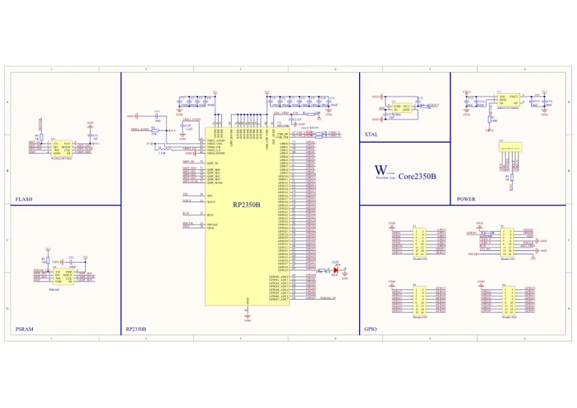

# Core2350B

**Waveshare** · RP2350

Revision: Not identified

Coverage: Manufacturer references available; physical pinout and complete connector review are tracked separately

[Browse all manufacturers](../../../../BROWSE.md) · [Devices & IoT](../../../../DEVICES.md) · [Open in the browser guide](https://valleytech-black-wire-guide.pages.dev/?board=waveshare-rp2350-core2350b)

## Datasheets and original documentation

Board datasheet: **not yet recorded**. Visual reference: **available**.

[Manufacturer model documentation](https://www.waveshare.com/wiki/Core2350B0)

- **schematic / board**: [Pico 2 Schematic — schematic](https://files.waveshare.com/wiki/common/Pico-2-schematic.pdf) · [saved document](../../../../library/media/66093b01f7b4cb3cfdd35cf0c4419c2630495f585e584bacbdfafa8676b937e6.pdf)
- **schematic / board**: [Schematic — schematic](https://files.waveshare.com/wiki/Core2350B0/Core2350B.pdf) · [saved document](../../../../library/media/ea3e5f74072c949a84041436b8b7dd71b78774bd4eb24499581f45b9c8cb9e7b.pdf)

A chip datasheet, schematic and board datasheet have different scopes. Match the exact hardware revision.

[Documentation coverage and remaining gaps](../../../../DOCUMENTATION.md)

## Pinout

**pinout image** · Reviewed source · JPG

[Open original reference](../../../../library/media/f9a1e443a5b4a73cb487b1c22ae95a2e7fbd236160453be55563e0ca8d6ce05a.jpg)

**Credit and rights:** Not recorded; retain original attribution. Source/manufacturer: Waveshare.

[Source 1](https://www.waveshare.com/w/upload/d/d9/Core2350B0-details-inter%283%29.jpg) · [Source 2](https://www.waveshare.com/wiki/Core2350B0) · [Source 3](https://www.waveshare.com/core2350b.htm)

Image revision: Not identified

SHA-256: `f9a1e443a5b4a73cb487b1c22ae95a2e7fbd236160453be55563e0ca8d6ce05a`

## Pico 2 Schematic — schematic

**reference PDF** · Source model/link and PDF signature/title checked; individual pin assignments and electrical validation pending · PDF

[Open original reference](../../../../library/media/66093b01f7b4cb3cfdd35cf0c4419c2630495f585e584bacbdfafa8676b937e6.pdf)

**Credit and rights:** Original publisher/manufacturer artwork; redistribution and print rights not established. Attribution is not a license grant.. Source/manufacturer: Waveshare.

[Source 1](https://files.waveshare.com/wiki/common/Pico-2-schematic.pdf) · [Source 2](https://docs.waveshare.com/RP2350-Touch-LCD-1.54/Resources-And-Documents)

Original document linked from this model’s manufacturer page. Preserve the document’s exact revision and named subassembly scope; a linked accessory schematic is not a whole-device pinout. This is a circuit schematic, not a physical board pinout.

Image revision: Use the revision printed in the original document; do not assume all hardware revisions are interchangeable

SHA-256: `66093b01f7b4cb3cfdd35cf0c4419c2630495f585e584bacbdfafa8676b937e6`

## Schematic — schematic

**reference PDF** · Source model/link and PDF signature/title checked; individual pin assignments and electrical validation pending · PDF

[Open original reference](../../../../library/media/ea3e5f74072c949a84041436b8b7dd71b78774bd4eb24499581f45b9c8cb9e7b.pdf)

**Credit and rights:** Original publisher/manufacturer artwork; redistribution and print rights not established. Attribution is not a license grant.. Source/manufacturer: Waveshare.

[Source 1](https://files.waveshare.com/wiki/Core2350B0/Core2350B.pdf) · [Source 2](https://www.waveshare.com/wiki/Core2350B0)

Original document linked from this model’s manufacturer page. Preserve the document’s exact revision and named subassembly scope; a linked accessory schematic is not a whole-device pinout. This is a circuit schematic, not a physical board pinout.

Image revision: Use the revision printed in the original document; do not assume all hardware revisions are interchangeable

SHA-256: `ea3e5f74072c949a84041436b8b7dd71b78774bd4eb24499581f45b9c8cb9e7b`

Pin assignments have not been independently electrically verified. Check board revision before wiring.
