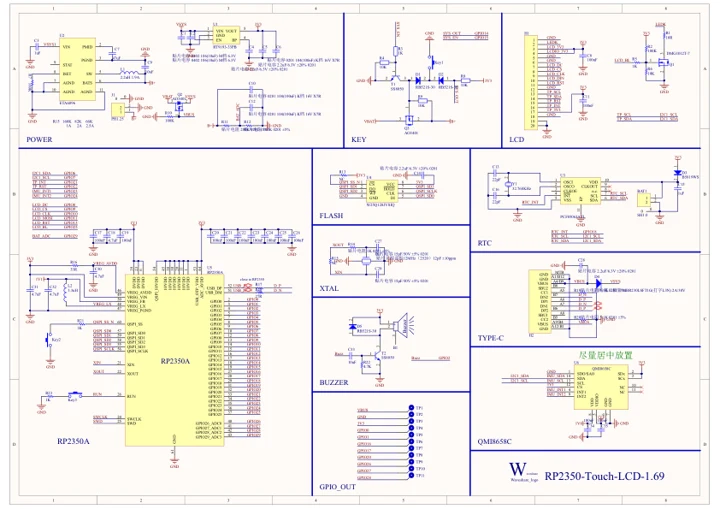

# RP2350-Touch-LCD-1.69

**Waveshare** · RP2350

Revision: Not identified

Coverage: Manufacturer references available; physical pinout and complete connector review are tracked separately

[Browse all manufacturers](../../../../BROWSE.md) · [Devices & IoT](../../../../DEVICES.md) · [Open in the browser guide](https://valleytech-black-wire-guide.pages.dev/?board=waveshare-rp2350-rp2350-touch-lcd-1-69)

## Datasheets and original documentation

Board datasheet: **not yet recorded**. Visual reference: **available**.

[Manufacturer model documentation](https://www.waveshare.com/wiki/RP2350-Touch-LCD-1.69)

- **schematic / board**: [Pico 2 Schematic — schematic](https://files.waveshare.com/wiki/common/Pico-2-schematic.pdf) · [saved document](../../../../library/media/66093b01f7b4cb3cfdd35cf0c4419c2630495f585e584bacbdfafa8676b937e6.pdf)
- **schematic / board**: [Schematic — schematic](https://files.waveshare.com/wiki/RP2350-Touch-LCD-1.69/RP2350-Touch-LCD-1.69.pdf) · [saved document](../../../../library/media/ae006e7fa74f6e28f870f598ca67e44327a9aeae5d83943ee624d6b53050b4c4.pdf)

A chip datasheet, schematic and board datasheet have different scopes. Match the exact hardware revision.

[Documentation coverage and remaining gaps](../../../../DOCUMENTATION.md)

## Pinout

**pinout image** · Reviewed source · JPG

[Open original reference](../../../../library/media/8122323c8131b881b0f10876f1fa078cf02dd1042633b8985326a7f9998bf1cd.jpg)

**Credit and rights:** Not recorded; retain original attribution. Source/manufacturer: Waveshare.

[Source 1](https://www.waveshare.com/img/devkit/RP2350-Touch-LCD-1.69/RP2350-Touch-LCD-1.69-details-9.jpg) · [Source 2](https://www.waveshare.com/rp2350-touch-lcd-1.69.htm)

Image revision: Not identified

SHA-256: `8122323c8131b881b0f10876f1fa078cf02dd1042633b8985326a7f9998bf1cd`

## Pinout

**pinout image** · Reviewed source · JPG

[Open original reference](../../../../library/media/308b1a164ca770f73d2760f544a973975db746dba1d11c6d8f34d90118c15565.jpg)

**Credit and rights:** Not recorded; retain original attribution. Source/manufacturer: Waveshare.

[Source 1](https://www.waveshare.com/w/upload/5/58/800px-RP2350-Touch-LCD-1.69-details-9.jpg) · [Source 2](https://www.waveshare.com/wiki/RP2350-Touch-LCD-1.69)

Image revision: Not identified

SHA-256: `308b1a164ca770f73d2760f544a973975db746dba1d11c6d8f34d90118c15565`

## Pico 2 Schematic — schematic

**reference PDF** · Source model/link and PDF signature/title checked; individual pin assignments and electrical validation pending · PDF

[Open original reference](../../../../library/media/66093b01f7b4cb3cfdd35cf0c4419c2630495f585e584bacbdfafa8676b937e6.pdf)

**Credit and rights:** Original publisher/manufacturer artwork; redistribution and print rights not established. Attribution is not a license grant.. Source/manufacturer: Waveshare.

[Source 1](https://files.waveshare.com/wiki/common/Pico-2-schematic.pdf) · [Source 2](https://docs.waveshare.com/RP2350-Touch-LCD-1.54/Resources-And-Documents)

Original document linked from this model’s manufacturer page. Preserve the document’s exact revision and named subassembly scope; a linked accessory schematic is not a whole-device pinout. This is a circuit schematic, not a physical board pinout.

Image revision: Use the revision printed in the original document; do not assume all hardware revisions are interchangeable

SHA-256: `66093b01f7b4cb3cfdd35cf0c4419c2630495f585e584bacbdfafa8676b937e6`

## Schematic — schematic

**reference PDF** · Source model/link and PDF signature/title checked; individual pin assignments and electrical validation pending · PDF

[Open original reference](../../../../library/media/ae006e7fa74f6e28f870f598ca67e44327a9aeae5d83943ee624d6b53050b4c4.pdf)

**Credit and rights:** Original publisher/manufacturer artwork; redistribution and print rights not established. Attribution is not a license grant.. Source/manufacturer: Waveshare.

[Source 1](https://files.waveshare.com/wiki/RP2350-Touch-LCD-1.69/RP2350-Touch-LCD-1.69.pdf) · [Source 2](https://www.waveshare.com/wiki/RP2350-Touch-LCD-1.69)

Original document linked from this model’s manufacturer page. Preserve the document’s exact revision and named subassembly scope; a linked accessory schematic is not a whole-device pinout. This is a circuit schematic, not a physical board pinout.

Image revision: Use the revision printed in the original document; do not assume all hardware revisions are interchangeable

SHA-256: `ae006e7fa74f6e28f870f598ca67e44327a9aeae5d83943ee624d6b53050b4c4`

Pin assignments have not been independently electrically verified. Check board revision before wiring.
