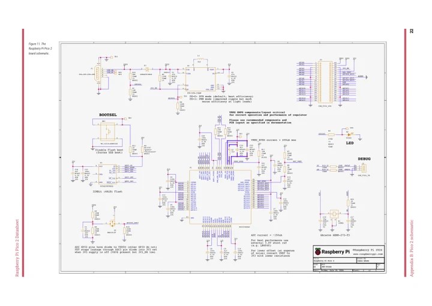
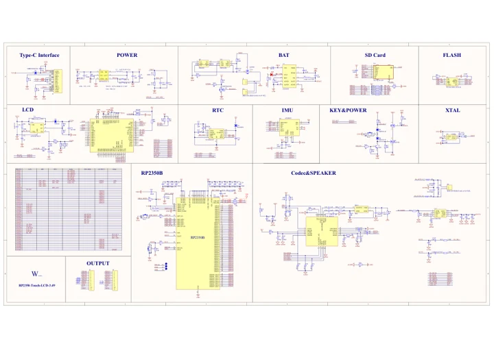

# RP2350-Touch-LCD-3.49

**Waveshare** · RP2350

Revision: Not identified

Coverage: Manufacturer references available; physical pinout and complete connector review are tracked separately

[Browse all manufacturers](../../../../BROWSE.md) · [Devices & IoT](../../../../DEVICES.md) · [Open in the browser guide](https://valleytech-black-wire-guide.pages.dev/?board=waveshare-rp2350-rp2350-touch-lcd-3-49)

## Datasheets and original documentation

Board datasheet: **not yet recorded**. Visual reference: **available**.

[Manufacturer model documentation](https://www.waveshare.com/wiki/RP2350-Touch-LCD-3.49)

- **schematic / board**: [Pico 2 Schematic — schematic](https://files.waveshare.com/wiki/common/Pico-2-schematic.pdf) · [saved document](../../../../library/media/66093b01f7b4cb3cfdd35cf0c4419c2630495f585e584bacbdfafa8676b937e6.pdf)
- **schematic / board**: [Schematic — schematic](https://files.waveshare.com/wiki/RP2350-Touch-LCD-3.49/RP2350-Touch-LCD-3.49.pdf) · [saved document](../../../../library/media/3cffd7ffb9e30878e7d4fbf18b4d5b70c24bcd4a3bff0c6a80672556bd9ae4f2.pdf)

A chip datasheet, schematic and board datasheet have different scopes. Match the exact hardware revision.

[Documentation coverage and remaining gaps](../../../../DOCUMENTATION.md)

## Pinout

**pinout image** · Reviewed source · JPG

[Open original reference](../../../../library/media/da43df4df78a8a1b855811f703c379bf601d2c47b09e681007251185f3a910a3.jpg)

**Credit and rights:** Not recorded; retain original attribution. Source/manufacturer: Waveshare.

[Source 1](https://www.waveshare.com/img/devkit/RP2350-Touch-LCD-3.49/RP2350-Touch-LCD-3.49-details-inter.jpg) · [Source 2](https://www.waveshare.com/rp2350-touch-lcd-3.49.htm)

Image revision: Not identified

SHA-256: `da43df4df78a8a1b855811f703c379bf601d2c47b09e681007251185f3a910a3`

## Pinout

**pinout image** · Reviewed source · JPG

[Open original reference](../../../../library/media/fad703a4ce8cfb649368338a88ea065525213b1ad1fea86b2e5d9db772f1abca.jpg)

**Credit and rights:** Not recorded; retain original attribution. Source/manufacturer: Waveshare.

[Source 1](https://www.waveshare.com/w/upload/0/08/700px-RP2350-Touch-LCD-3.49-details-inter.jpg) · [Source 2](https://www.waveshare.com/wiki/RP2350-Touch-LCD-3.49)

Image revision: Not identified

SHA-256: `fad703a4ce8cfb649368338a88ea065525213b1ad1fea86b2e5d9db772f1abca`

## Pico 2 Schematic — schematic

**reference PDF** · Source model/link and PDF signature/title checked; individual pin assignments and electrical validation pending · PDF

[Open original reference](../../../../library/media/66093b01f7b4cb3cfdd35cf0c4419c2630495f585e584bacbdfafa8676b937e6.pdf)

**Credit and rights:** Original publisher/manufacturer artwork; redistribution and print rights not established. Attribution is not a license grant.. Source/manufacturer: Waveshare.

[Source 1](https://files.waveshare.com/wiki/common/Pico-2-schematic.pdf) · [Source 2](https://docs.waveshare.com/RP2350-Touch-LCD-1.54/Resources-And-Documents)

Original document linked from this model’s manufacturer page. Preserve the document’s exact revision and named subassembly scope; a linked accessory schematic is not a whole-device pinout. This is a circuit schematic, not a physical board pinout.

Image revision: Use the revision printed in the original document; do not assume all hardware revisions are interchangeable

SHA-256: `66093b01f7b4cb3cfdd35cf0c4419c2630495f585e584bacbdfafa8676b937e6`

## Schematic — schematic

**reference PDF** · Source model/link and PDF signature/title checked; individual pin assignments and electrical validation pending · PDF

[Open original reference](../../../../library/media/3cffd7ffb9e30878e7d4fbf18b4d5b70c24bcd4a3bff0c6a80672556bd9ae4f2.pdf)

**Credit and rights:** Original publisher/manufacturer artwork; redistribution and print rights not established. Attribution is not a license grant.. Source/manufacturer: Waveshare.

[Source 1](https://files.waveshare.com/wiki/RP2350-Touch-LCD-3.49/RP2350-Touch-LCD-3.49.pdf) · [Source 2](https://www.waveshare.com/wiki/RP2350-Touch-LCD-3.49)

Original document linked from this model’s manufacturer page. Preserve the document’s exact revision and named subassembly scope; a linked accessory schematic is not a whole-device pinout. This is a circuit schematic, not a physical board pinout.

Image revision: Use the revision printed in the original document; do not assume all hardware revisions are interchangeable

SHA-256: `3cffd7ffb9e30878e7d4fbf18b4d5b70c24bcd4a3bff0c6a80672556bd9ae4f2`

Pin assignments have not been independently electrically verified. Check board revision before wiring.
